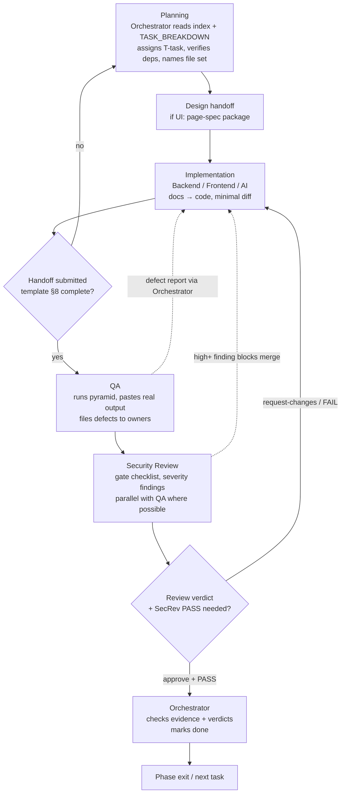

# Agent Workflow — SmartHomeAI

| Field | Value |
|---|---|
| Version | 0.1.0 |
| Status | Draft for review |
| Date | 2026-10-15 |
| Extends | [AGENT_SPEC.md](AGENT_SPEC.md) — universal rules (§2), permissions matrix (§3), handoffs (§5), prohibited actions (§6); role details live in the [role documents](AGENT_SPEC.md) |

## 1. Mission

This document is the coordination mechanics for the SmartHomeAI agent team: the end-to-end
workflow from planning to `done`, the copy-pasteable handoff template, the task state machine,
rules for parallel work, and the conflict-handling route. It makes AGENT_SPEC §5 executable
without ambiguity: work flows **Product → Design → Backend/Frontend/AI → QA → SecRev → Review →
Orchestrator**, and nobody declares completion except the Orchestrator, with evidence.

## 2. Scope

**In scope:** process rules for all roles — phase flow, handoff format, task statuses, parallel
work constraints, registry ownership, conflict routing (incl. the T-003 CONTRACT.md path).
**Out of scope:** role missions/permissions (role docs + AGENT_SPEC §3), product/design/content
decisions (their owners), test strategy (TEST_PLAN), security verdict rules (SECURITY_REVIEW_AGENT.md).

## 3. Inputs

- [../planning/TASK_BREAKDOWN.md](../planning/TASK_BREAKDOWN.md) (task IDs, dependencies) and
  [../planning/IMPLEMENTATION_PLAN.md](../planning/IMPLEMENTATION_PLAN.md) (phases, exit criteria).
- Handoff reports from roles; rejection notices; conflict/ambiguity reports; human gate
  decisions (T-003 → T-004 → T-005); [../index.md](../index.md) D1–D7 + ground rules.
- **Trigger events:** task assignment, handoff submission, handoff rejection, conflict report,
  phase-exit request, escalation from a Review↔author disagreement.

## 4. Outputs

- Executed workflow records: assignments, handoffs, verdicts, gate results, status transitions —
  all as Markdown attached to task entries with real evidence.
- The handoff template instance per task (§8), conflict resolution entries, daily coordination notes.
- Nothing is an output of this process without an ID and evidence — the workflow produces records,
  not assurances.

## 5. Allowed tools

- Process roles use the same environment: **PowerShell on Windows** (Node 24.13.0, npm 11.6.2,
  git 2.52.0 per T-001). Per-role tool lists are in each role doc §5.
- Shared verification commands referenced by handoffs: `npm run lint`, `npm run typecheck`,
  `npm run test`, `npm run build`, `npx prisma validate`, `npx cdk diff`, `npx playwright test`,
  `npm run test:ai` — each run by the role permitted to run it (AGENT_SPEC §3).
- **Environment constraints:** dev DB is the Supabase project with a local PostgreSQL 16 test
  fallback (T-020 — DB roles document their choice); live Groq only from local dev (AI role);
  AWS actions only AwsInfra with reviewed diffs.

## 6. Permissions

[AGENT_SPEC.md](AGENT_SPEC.md) §3 governs every role; this workflow adds only coordination
rules: **(a)** the Orchestrator is the sole status writer; **(b)** reviewers/security reviewers
issue verdicts, not fixes; **(c)** 🔶 capabilities activate only with an Orchestrator assignment
or a passing review; **(d)** merge requires Review approval (+ CI green, + SecRev PASS when
security-relevant). No rule here weakens a ⛔ in §3.

## 7. Dependencies

- **Depends on:** all ten role documents (executors), TASK_BREAKDOWN (sequencing), human gates
  (Phase 1), QA/SecRev outputs (evidence layer).
- **Depended on by:** every role (participates in this flow), IMPLEMENTATION_PLAN phase exits
  (which consume workflow evidence), CONTRIBUTING/README process docs.

## 8. Handoff rules

**End-to-end flow:**



QA and SecRev run **in parallel** whenever the diff is ready for both; Review starts when the
implementation handoff lands and may run alongside QA — but a QA red run or SecRev FAIL
invalidates an earlier approval until re-reviewed.

**Handoff template (copy-pasteable — required in full):**

```text
Task: T-### — <title>
Role: <role>           From: <role> → To: <next role(s)>
Files changed:
  - <path> (+ what changed, one line each)
Verification commands + REAL output (paste, do not summarize):
  $ <command>   -> <actual result lines>
  $ <command>   -> <actual result lines>
  (If not run: "not run — reason" is required and acceptable)
Test IDs: added <…> | run green <…> | red/not-run <…>
Doc updates: <files changed or "none needed — why">
Security/impact notes: <endpoints touched? secrets? prompts? yes/no + SecRev needed?>
Open questions: <… or none>
Caveats / not done: <explicit list — required, may be "none">
Received by: <role> <date>   Verdict: <approve | request-changes + blockers> (Review/SecRev)
```

**Task state machine:**

```mermaid
stateDiagram-v2
    [*] --> todo: Orchestrator creates T-task
    todo --> in-progress: assignment accepted, deps verified
    in-progress --> review: handoff submitted w/ evidence
    review --> in-progress: rejected (reasons attached)
    review --> done: Orchestrator verifies evidence + required verdicts
    todo --> blocked: dependency missing
    in-progress --> blocked: waiting on dep/gate
    blocked --> todo: dependency cleared
    done --> [*]: immutable (defects become new T-task)
```

Rules: `done` only with verification output + required verdicts (QA evidence; SecRev PASS when
security-relevant) — all statuses are written by the Orchestrator (AGENT_SPEC §5.4).

**Parallel work rules:**
- **No two agents edit the same file** in the same window — single-writer per file per task.
- **Registry ownership:** product/requirements → Product · design → Design · planning + task
  statuses → Orchestrator · architecture docs → owner named in the assignment (ADR proposals need
  Review/SecRev 🔶 + human) · prompts + `src/server/assistant` + `src/lib/providers` → AI ·
  `src/app`/`src/components`/`src/client` → Frontend · rest of `src/server` + `src/lib/validation`
  + `src/app/api` → Backend · `prisma/**` → Backend 🔶 with Review · `tests/**` → QA ·
  `infrastructure/**` + `.github/workflows/**` → AwsInfra · `docs/agents/**` → Orchestrator (§6).
- **Joint tasks** (T-015, T-036, T-056, T-062, T-072) pre-declare each side's file set in the
  assignment; within a joint task, file sets must not intersect.
- Reading across registries is always allowed; cross-editing requires 🔶 assignment.
- Before starting, each role checks the assignment for overlap with active tasks (Orchestrator's
  daily checklist double-checks — [ORCHESTRATOR_AGENT.md](ORCHESTRATOR_AGENT.md) §8).

**Handling documentation conflicts:**
1. Stop writing to the disputed files (freeze both sides).
2. Report to the **Orchestrator** with: file(s), both positions, registry owners, IDs affected.
3. Orchestrator classifies: process conflict → resolved by this doc's rules; content conflict →
   adjudication.
4. **`docs/CONTRACT.md` path (T-003):** adjudicated **2026-10-17** — the index-rooted set
   ([../index.md](../index.md) D1–D7) won every conflict point (FR/US/BR/NFR numbering, API base
   path, auth mechanism, WCAG level, RTO, cost ceiling, region, event semantics, task ranges).
   Rationale and cross-review findings F-1…F-8 are recorded in CONTRACT.md §0; §9 remains the live
   `D-OPEN-*` register. CONTRACT.md may now only be edited in §0/§9 through an explicit
   adjudication; implementers follow [../index.md](../index.md) D1–D7. (The file was frozen as a
   competing registry until this adjudication; T-003 closes with evidence — TASK_BREAKDOWN §4.)
5. After adjudication: doc owners apply the decision to their files; the Orchestrator records
   outcomes and clears blocked tasks. Nobody "fixes" conflicts by silent alignment.

## 9. Prohibited actions

Universal prohibutions apply by reference: [AGENT_SPEC.md](AGENT_SPEC.md) §6 and §2.

Workflow-specific:
- Skipping stages (implementation without assignment, merge without verdicts, `done` without
  evidence), or writing statuses other than the Orchestrator.
- Starting work whose file set overlaps another active task; editing outside your registry.
- Handoffs without the §8 template fields (especially missing "not done" caveats).
- Claiming QA/SecRev/Review sign-off that was not issued in text, with evidence.
- Resolving a doc conflict by editing the other registry — route to Orchestrator → T-003.
- Editing `docs/CONTRACT.md` outside a T-003-style adjudication (only §0 and §9 are live), or treating its SUPERSEDED sections as authority.

## 10. Acceptance criteria

- Every completed task shows a full trail: assignment → handoff(s) with real output → QA evidence
  → SecRev PASS (if security-relevant) → Review APPROVE → Orchestrator `done`.
- No file has two writers in flight (daily checklist + review confirm); joint tasks ran with
  disjoint file sets.
- All handoffs received used the §8 template; rejections cite concrete reasons and were routed
  via the Orchestrator.
- Conflicts have dated resolution records (CONTRACT.md §0 — adjudicated 2026-10-17), and
  implementers are documented as following index D1–D7.
- A spot-check of any `done` task reproduces its claimed verification output.
