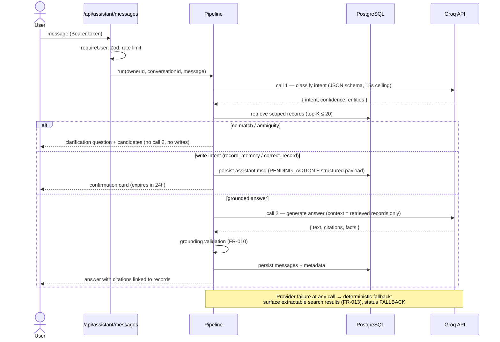

# AI Architecture — SmartHomeAI Assistant

| Field | Value |
|---|---|
| Version | 0.1.0 |
| Status | Draft for review |
| Provider | **Groq** (required initial provider, D3/C-1) behind a provider-agnostic interface |
| Default model | `llama-3.3-70b-versatile` (configurable via `GROQ_MODEL`; verify availability at implementation time) |
| Prompt specs | [prompts/](../prompts/SYSTEM_PROMPT.md) |

---

## 1. Positioning: retrieval-first, LLM-second

The assistant is a **grounded question-answering and confirmed-write layer over the
user's database records**. Ordering is non-negotiable:

1. The database is the source of truth.
2. Server-side retrieval selects records (scoped to the authenticated owner).
3. The LLM receives only those records and produces natural language + structured output.
4. Server-side validation checks the output before the user ever sees it.

The LLM never queries the database directly, never generates SQL, never invents records,
and never executes writes. Writes happen only through the normal validated services after
explicit user confirmation (FR-024).

## 2. Provider abstraction

```ts
// src/lib/providers/llm/types.ts (design sketch — implemented in T-050)
export interface LlmProvider {
  readonly name: string;
  complete(req: {
    system: string;
    messages: { role: "user" | "assistant"; content: string }[];
    jsonSchema?: JsonSchema;        // structured-output request when supported
    timeoutMs: number;              // hard ceiling per attempt
    maxRetries: number;             // bounded; retry only 429/5xx/network
    maxOutputTokens: number;
  }): Promise<{ content: string; model: string; latencyMs: number;
                promptTokens?: number; completionTokens?: number }>;
}
```

- `GroqProvider` is the only production implementation for the MVP (OpenAI-compatible chat
  completions API, `baseURL=https://api.groq.com/openai/v1`, JSON object mode).
- `MockProvider` returns canned fixture outputs for tests/evals — deterministic, offline.
- Swapping providers (Bedrock, OpenAI, local) requires one new adapter + config; no call
  sites change. This is the whole extent of "provider independence" for the MVP.
- The API key lives only in server-side configuration (`GROQ_API_KEY`, AWS Secrets Manager
  in cloud environments). It is never sent to the client, never logged.

**Operational bounds (defaults, env-tunable):** timeout 15 s per attempt; 2 retries with
exponential backoff + jitter (429/5xx/network only); `maxOutputTokens` 1024; per-user
assistant cap 100 messages/day and 20/minute (BR-12); conversation length fed to the model
bounded to the last 12 messages + a server-generated summary line for older context.

## 3. Processing pipeline

```text
1. authenticate      requireUser() → ownerId (never from payload)
2. validate input    Zod: message ≤ 2000 chars, conversationId ownership
3. rate limit        per-user bucket → 429 RATE_LIMITED
4. classify intent   LLM call #1 (structured): lookup_location | list_contents |
                     search_fuzzy | record_memory | correct_record | chit_chat |
                     help | unknown  (+ confidence + entities)
5. retrieve          deterministic DB retrieval under ownerId scope, top-K ≤ 20
                     (exact → prefix → trigram → FTS ranking; aliases when P1)
6. decide            data-independent (chit_chat/help) → answer directly
                     ambiguity (FR-009) → clarification question + candidates
                     write intent → build pendingAction (no DB write yet)
                     otherwise → generation call #2 with retrieved context
7. generate          LLM call #2 (structured): answer text + citations + facts[]
8. validate          FR-010 grounding check: every cited id must exist in the
                     retrieved set; claims referencing unknown records → reject →
                     safe fallback answer + metric ai.ungrounded_detected
9. confirm (writes)  persist pendingAction on the assistant message (status
                     PENDING_ACTION); execution only via
                     POST /api/assistant/actions/:id/decision (FR-024)
10. persist + return user/assistant Message rows (content + metadata),
    reply DTO with citations/candidates/pendingAction/meta
```



## 4. Structured outputs

Every LLM call requests JSON (Groq JSON object mode) and is validated with Zod on arrival;
malformed output after one repair attempt is treated as provider failure (FR-013 path).
A request uses **at most two calls**: (1) classification — and, for write intents, extraction
with the retrieved records in scope to resolve IDs — and (2) generation for read answers.
Extraction reuses the same structured-output mechanism; there is no third, undescribed call type.

- **Classification output:** `{ intent, confidence (0–1), entities: { itemNames[], aliases[], locationPhrases[], timeExpressions[], relativeDate }, proposedAction? }`
- **Generation output:** `{ text (≤ 1200 chars), citations: [{ type: "item"|"location"|"event", id }], facts: [{ kind, id, occurredAt? }], inferred: boolean }`

Server rules applied after validation: candidate IDs are checked against the retrieved set;
unknown IDs are stripped and counted; `text` length is clamped; HTML is escaped by the
rendering layer (assistant output is rendered as plain text + links, never raw HTML).

## 5. Prompt specifications

Versioned Markdown files under [docs/prompts/](../prompts/SYSTEM_PROMPT.md) — the exact
system prompts, classification rules, extraction rules, and answer-generation templates the
AI_AGENT implements. Prompts are code-reviewed documents: changing behavior starts with a
prompt-file change plus an evaluation-suite run.

## 6. Safety and correctness rules (binding)

| # | Rule | Enforced by |
|---|---|---|
| S-1 | Retrieved DB records are the only allowed source of facts | Prompt + grounding validator (FR-010) |
| S-2 | Historical records are never presented as guaranteed current physical location | Mandatory caveat phrasing (ANSWER_GENERATION.md) |
| S-3 | User input and stored names are **untrusted data**: they are delimited in prompts, never interpreted as instructions (prompt-injection defense) | Prompt design + injection eval cases |
| S-4 | Authorization is enforced outside the LLM; the model receives no other-user data and no capability to fetch data | Pipeline (step 1/5) |
| S-5 | The LLM never executes SQL or arbitrary tools; its only outputs are the two JSON shapes | Adapter interface |
| S-6 | Every write goes through validated services after explicit confirmation; pending actions expire | FR-024 flow |
| S-7 | Keys and privileged operations stay server-side | Deployment + Secrets Manager |
| S-8 | Context and retries are bounded; timeouts are hard | Provider adapter bounds |
| S-9 | No chain-of-thought or internal reasoning is exposed; only final answer text | Output schemas |
| S-10 | Logs carry operational metadata only — never message content, item names, or locations | Logger allowlist + tests |

## 7. Fallback and degradation (FR-013)

| Failure | Behavior |
|---|---|
| Groq 429 | Backoff + retry ×2 → `AI_UNAVAILABLE` + deterministic search fallback using a keyword heuristic over the message |
| Groq 5xx / network / timeout | Same as above; metric `ai.fallback` incremented |
| Malformed model output | One repair attempt ("return valid JSON matching the schema") → else fallback path |
| Grounding validation failure | Replace with safe fallback answer ("I found records but couldn't summarize them reliably — here's what I found") + `ai.ungrounded_detected` |
| Rate-limited user | 429 with retry guidance; inventory UI fully functional |

Deterministic search (FR-005) is always available and needs no LLM; the assistant is an
acceleration layer on top of it, never a single point of failure.

## 8. Search technology decision: no vectors in the MVP (D6)

| Option | Verdict | Rationale |
|---|---|---|
| **PostgreSQL FTS (`simple` config) + `pg_trgm`** (chosen) | ✅ | Personal-scale vocabulary; typo tolerance; zero extra infra; already paid for |
| pgvector + embeddings | ❌ for MVP | Adds infra, cost, async indexing, and evaluation burden; retrieval quality gain unproven at this scale. Revisit trigger: fuzzy+FTS precision < 80% on the search eval set (AIE-020-*), or P2 semantic features (FR-029) materialize |
| OpenSearch / external vector DB | ❌ | Operating cost and complexity unjustifiable |

This evaluation is recorded here as required; a future ADR supersedes D6 only with
measured evidence.

## 9. AI evaluation (QA gate)

- Suite lives in `tests/ai-evaluation/` with fixtures in
  [prompts/EVALUATION_CASES.md](../prompts/EVALUATION_CASES.md): intent-classification
  cases, extraction cases, grounded-answer cases, ambiguity cases, injection cases, and
  negative (no-record) cases.
- Runs against `MockProvider` fixtures in CI (deterministic, free) and periodically against
  live Groq in a scheduled job (recorded, labeled with model id + date).
- Release gates: ≥ 70% fully-correct grounded answers; **0 fabricated records**; intent
  accuracy ≥ 90% on the labeled set. Results are written to the repo's CI artifacts, never
  fabricated in docs.
