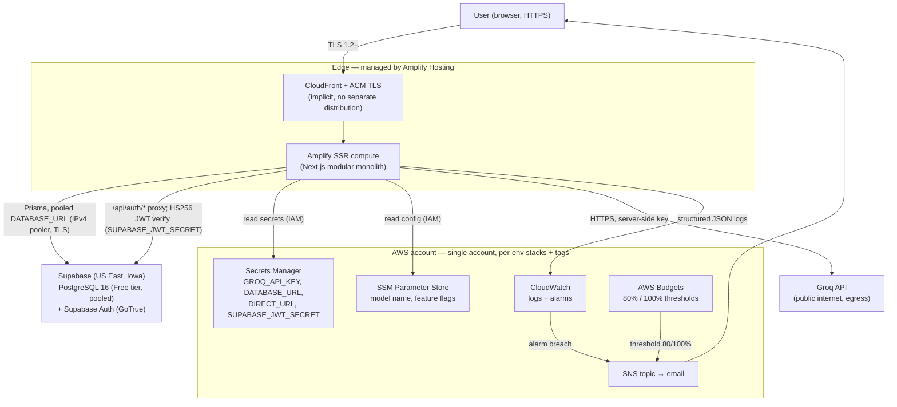

# AWS Architecture — SmartHomeAI

| Field | Value |
|---|---|
| Version | 0.1.0 |
| Status | Draft for review |
| Date | 2026-10-15 |
| Decisions | D2 (PostgreSQL on Supabase), D4 (Amplify + CDK), D5 (Supabase Auth) — see [index.md §4](../index.md) *(all amended 2026-10-17 by [ADR-005](adr/ADR-005-supabase.md))* |
| Implementation tasks | T-070 (CDK stack), T-071 (Amplify + env wiring), T-074 (budget alarms) — [TASK_BREAKDOWN](../planning/TASK_BREAKDOWN.md) |

> **Status of everything AWS-related in this document:** *proposed, not provisioned.* No AWS
> resource exists yet; nothing here is a record of a deployment, a test result, or a bill.
> All prices are **assumptions** researched 2026-09/10 (us-east-1) and must be re-verified
> before purchase — the canonical cost model lives in
> [COST_ESTIMATION.md](../planning/COST_ESTIMATION.md).
>
> **Amended 2026-10-17 by [ADR-005](adr/ADR-005-supabase.md):** the database and auth moved
> to Supabase (Supabase Free tier for the MVP; Supabase Auth replaces Cognito). AWS now
> hosts Amplify Hosting (+ implicit CloudFront/ACM), Secrets Manager, CloudWatch
> alarms/logs, and AWS Budgets only — **no Cognito, no RDS, no VPC**. Sections that
> describe the superseded RDS/Cognito choices are retained as rationale and marked
> *"Superseded 2026-10-17 by ADR-005"*. New reality: §2.1, §7, §8.

---

## 1. Goals and Well-Architected mapping

We use the AWS Well-Architected Framework as a checklist, not as a goal in itself:
[pillars of the framework](https://docs.aws.amazon.com/wellarchitected/latest/framework/the-pillars-of-the-framework.html)
(external reference, accessed as design guidance 2026-10).

| Pillar | What it means for SmartHomeAI (concrete requirement) | Where it is specified |
|---|---|---|
| **Operational excellence** | One Git-based pipeline; infrastructure as code (CDK in `infrastructure/`); every release reproducible from a tag; smoke test T-072 gates staging | [DEPLOYMENT.md](DEPLOYMENT.md) |
| **Security** | Supabase Auth + server-side authorization on every protected operation (FR-012); TLS 1.2+ everywhere; secrets never in git or client bundles; least-privilege IAM; log redaction | [SECURITY.md](SECURITY.md) |
| **Reliability** | 99.5% monthly availability target (NFR-002); RPO ≤ 24 h / RTO ≤ 4 h (**targets**, see [DISASTER_RECOVERY.md](DISASTER_RECOVERY.md)); scheduled `supabase db dump` exports + restore drill (T-073) — Supabase Free has no automatic backups; LLM failure never disables CRUD (FR-013) | [DISASTER_RECOVERY.md](DISASTER_RECOVERY.md), [AI_ARCHITECTURE.md](AI_ARCHITECTURE.md) |
| **Performance efficiency** | p95 < 400 ms excluding AI, AI turn p95 < 6 s (NFR-001); right-sized Supabase compute (Free shared Nano for MVP; Micro on Pro); CDN and SSR caching provided by the hosting; no premature distribution | [SYSTEM_ARCHITECTURE.md](SYSTEM_ARCHITECTURE.md) §6, [API_SPEC.md](API_SPEC.md) |
| **Cost optimization** | MVP budget ≤ USD 25/month (PRD C-4 / BO-3); free-tier-aware service choices; every service below carries a labeled cost assumption; budget alarms required (T-074) | [COST_ESTIMATION.md](../planning/COST_ESTIMATION.md) |
| **Sustainability** | Single region, single small compute, right-sizing over over-provisioning, Supabase Free auto-pauses after 1 week idle, no idle dev fleets | §10 of this document |

Design rule (index.md §6.5): **no AWS service is added that a documented requirement does not
justify.** Every service below states that justification.

---

## 2. Service selection — REQUIRED for MVP

| AWS service | Purpose in SmartHomeAI | Required for MVP | Cost implication (assumption, 2026-09/10 research, us-east-1 — re-verify) | Operational complexity | Why not the alternative |
|---|---|---|---|---|---|
| **AWS Amplify Hosting (SSR)** | Hosts the Next.js modular monolith (D1/D4): Git-connected CI/CD, SSR compute, managed TLS + CDN in front | **Yes** | Build $0.01/min after 1,000 free min; CDN storage $0.023/GB-mo after 5 GB; data served $0.15/GB after 15 GB; SSR compute free up to 100 GB-hrs/mo then $0.20/GB-hr → MVP expected ≈ $0–3/mo within free allowances (**assumption**) | Low — managed builds, no container/image ops for MVP | ECS/App Runner = container ops (fallback only, [ADR-004](adr/ADR-004-deployment.md)); Vercel = not AWS, weaker region control |
| **Amazon Cognito (Essentials tier)** | **Superseded 2026-10-17 by [ADR-005](adr/ADR-005-supabase.md)** — auth now lives on Supabase Auth (§2.1). *Rationale retained:* managed registration, login, recovery, email verification; app verified JWTs server-side; `ownerId` = token `sub` (D5) | **No — replaced by Supabase Auth** | *Historical assumption:* first 10,000 MAU/month free per account, then $0.015/MAU → MVP ≈ $0 | Low — managed flows; medium when custom UI/emails needed | Self-hosted Auth.js = email delivery + session store + more code (documented fallback in [SECURITY.md](SECURITY.md)); no auth at all is not an option |
| **Amazon RDS for PostgreSQL** | **Superseded 2026-10-17 by [ADR-005](adr/ADR-005-supabase.md)** — the system of record now lives on Supabase (§2.1). *Rationale retained:* `db.t4g.micro`, Single-AZ, 20 GB gp3, **DB in private subnet, no public endpoint** (D2 as originally decided) | **No — replaced by Supabase** | *Historical assumption:* $0.016/hr single-AZ ≈ $11.7/mo; gp3 20 GB × $0.115/GB-mo ≈ $2.30 → ≈ $14/mo. Free tier (750 hrs + 20 GB) covered **one** environment only | Medium — backups, patching via AWS, parameter/subnet/SG config in CDK | Aurora Serverless v2 min-ACU costs more at this scale ([ADR-002](adr/ADR-002-database.md)); DynamoDB/MongoDB rejected for relational integrity; self-managed Postgres on EC2 = patching burden |
| **AWS Secrets Manager** | Stores `GROQ_API_KEY` and `DATABASE_URL` for staging/production (T-070, T-071); app/CI reads at deploy and runtime | **Yes** | $0.40/secret/mo (first 5 secrets free per account) → ≈ $0 with ≤ 5 secrets (**assumption**) | Low — CDK creates, IAM grants read; rotation is optional now | Plaintext env vars in git/CI = prohibited ([SECURITY.md](SECURITY.md) §4); SSM SecureString is viable but lacks built-in rotation/cross-account ergonomics — kept for *non-secret* config only |
| **Amazon CloudWatch** | Logs destination for app/hosting; alarms on error rate, AI fallback, app 5xx, budget — database metrics come from the Supabase dashboard, not CloudWatch (see [OBSERVABILITY.md](OBSERVABILITY.md)) | **Yes** | Alarms ≈ $0.10/alarm/mo (≈ $0.60 for ~6 alarms); log ingestion/retention small at MVP scale (**assumption**) | Low — log groups + metric filters + SNS email | No monitoring = blind to FR-013 fallback storms and 5xx regressions; third-party APM rejected (cost + personal data surface) |
| **AWS IAM** | Least-privilege roles for CDK deploy, Amplify build/SSR, humans via individual IAM users/SSO — see §6 | **Yes** | $0 (IAM itself is free) | Medium — policy review is ongoing discipline | Long-lived root keys or `AdministratorAccess` everywhere = rejected (least privilege, NFR-004) |
| **AWS Systems Manager Parameter Store (standard)** | Non-secret config: model name (`llama-3.3-70b-versatile`), feature flags, environment constants — referenced by stacks/app | **Yes** | Standard parameters free (**assumption**) | Low | Environment sprawl without a single source of truth; Secrets Manager for non-secrets wastes the 5-free-secret allowance |
| **AWS Budgets** | Budget alarm ≤ USD 25/mo target (C-4) with alerts at 80%/100% of threshold (T-074) | **Yes (tiny)** | Expected ≈ $0 at 1–2 budgets; AWS's free allowance for a small number of budgets — **assumption, verify current Budgets pricing** | Very low | Being surprised by cost violates BO-3; a spreadsheet cannot alert |

### 2.1 Supabase — database and auth (not an AWS service; ADR-005)

Database (D2) and auth (D5) live on **Supabase**, reached from the Amplify-hosted app over
the public internet (TLS). This is the production path for the MVP.

| Plan | Purpose in SmartHomeAI | Cost (verified at supabase.com/pricing 2026-10-15/17) | Key limits / notes |
|---|---|---|---|
| **Supabase Free** *(MVP)* | PostgreSQL 16 (Prisma) + Supabase Auth (GoTrue) for dev/staging MVP environments | **$0** | 500 MB disk; 2 active projects; shared Nano compute; **no automatic backups**; auto-pauses after 1 week idle; direct connection has no IPv4 — use the shared pooler for IPv4; built-in email service limited to ~2–3 emails/hour; Supabase Auth Free = 50,000 MAU included |
| **Supabase Pro** *(launch path)* | Upgrade trigger when Free caps bite (storage, pauses, email volume, backups) | **from $25/mo** | 8 GB disk; daily backups with 7-day retention; never pauses; $10 compute credit covers the first Micro instance; 100k MAU |

**Connection strings (Prisma):** runtime `DATABASE_URL` = pooled **transaction-mode** URL
(`?pgbouncer=true`, port **6543**); `DIRECT_URL` = direct connection (port **5432**) used
only by Prisma migrations (`prisma migrate deploy`). **Region:** Supabase `US East (Iowa)`
(`aws-us-east-1`) to co-locate with the default `us-east-1` AWS region. **Egress:** app
server → Supabase pooler is normal outbound HTTPS/TLS traffic from Amplify; no VPC, NAT
gateway, or security-group path is involved. Postgres RLS is not relied upon in the MVP —
Prisma/service-layer `ownerId` scoping owns authorization (FR-012; optional hardening
later, [SECURITY.md](SECURITY.md) §3.2).

---

## 3. Optional / deferred services

| AWS service | Required for MVP | Cost implication (assumption) | Decision | Justification |
|---|---|---|---|---|
| **AWS WAF** | **No** | ~$15/mo per app (plus rule charges) — **assumption** | **Defer to launch or evidence of abuse** | $15/mo is a large share of the ≤ $25/mo budget. Compensating controls: app-layer rate limiting (API_SPEC §1, 429 + `Retry-After`), Supabase Auth rate limiting, Zod validation, security headers (T-060). Re-evaluate at launch/abuse; risk registered as **R-10 in [../planning/RISKS.md](../planning/RISKS.md)** (this contract's historical `R-010`). Note the additional **assumption** (ADR-004) that Amplify-managed distributions may not accept arbitrary WAF associations — verify before purchasing |
| **Amazon CloudFront (separate distribution)** | **No** | Separate distribution ≈ $0.085/GB + request fees — **assumption** | **Not used** | Amplify Hosting already fronts SSR with a CDN and managed ACM TLS; a second distribution duplicates cost and config for zero measured gain. Only revisit if we leave Amplify (ADR-004 fallback ladder) |
| **Amazon S3** | **No** (P1 only) | Storage pennies; **assumption** | **Deferred to P1 item images (T-085 / FR-025)** | MVP has no file storage requirement; presigned PUT uploads are specified but not P0. Rejection rationale for *now*: an unused bucket is unmanaged surface + drift |
| **AWS Lambda + Amazon API Gateway** | **No** | Pay-per-request; cheap in isolation, but doubles the delivery pipeline | **Rejected — [ADR-001](adr/ADR-001-application-architecture.md)** | Second deployment track, second auth path, cold starts, distributed transactions, more IAM surface — unjustified for one small team and personal-scale load (D1) |
| **Amazon SES** | **No (conditional)** | ~$0.10/1,000 emails — **assumption** | **Adopt only if Supabase's built-in email service is insufficient** (R-10) | Supabase Free's built-in email service is rate-limited (~2–3 emails/hour) and may throttle verification/recovery emails; the primary remedy is configuring **custom SMTP** in Supabase, with SES as a possible SMTP provider. **Known risk, not a current provisioning item** |
| **Amazon ElastiCache / OpenSearch / vector database** | **No** | $11+/mo minimum — **assumption** | **Rejected for MVP** | D6 (FTS + `pg_trgm`), no shared cache needed for per-user in-memory caches, and search scale is personal-inventory scale ([AI_ARCHITECTURE §8](AI_ARCHITECTURE.md)) |
| **RDS Multi-AZ** | **No** | Roughly 2× instance cost (+ ~$11.7/mo) — **assumption** | **Superseded 2026-10-17 by [ADR-005](adr/ADR-005-supabase.md)** (no RDS; the equivalent decision is the Supabase Free → Pro upgrade path) | *Rationale retained:* Single-AZ met the MVP RTO ≤ 4 h target via restore-from-snapshot/PITR ([DISASTER_RECOVERY.md](DISASTER_RECOVERY.md)); revisit if availability requirements exceed 99.5% (NFR-002) |

---

## 4. Region selection

Region is tracked as open decision **D-OPEN-002** (CONTRACT.md); this table defines the
criteria so that decision is made once, with evidence.

| Criterion | Weight | Considerations |
|---|---|---|
| **Data residency / privacy** | High for EU users | If users or stakeholders require EU residency, choose `eu-central-1` (Frankfurt) and keep everything (database region, logs, secrets) there |
| **Service availability** | Gate | Amplify Hosting SSR, Supabase (DB + Auth), Secrets Manager, Budgets must all be available in the region (all mainstream regions qualify — **verify at decision time**) |
| **Latency to users** | Medium | One region close to the primary user base; CDN covers static/edge, SSR compute stays single-region |
| **Price** | Medium | Prices above are `us-east-1` research; other regions differ slightly — re-verify for the chosen region |
| **Free tier applicability** | Low | Supabase Free limits (2 active projects, shared compute) and AWS free allowances apply per account — do not split environments across regions/projects expecting double free tier |

**Default for the MVP: `us-east-1`** — the pricing assumptions in §2/§9 and
[COST_ESTIMATION.md](../planning/COST_ESTIMATION.md) are all denominated there. The Supabase
project is created in **Supabase `US East (Iowa)` (`aws-us-east-1`)** to co-locate
(ADR-005).

**Switch guidance to `eu-central-1`:** change the CDK `env` config (account + region), keep
*all* stacks in the one chosen region, re-verify the price table, and move the Supabase
project to a co-located Supabase region (§2.1) in the same exercise. Regions are **not** mixed:
one account, one region, all environments (§5).

---

## 5. Resource naming and tagging

**Naming convention:** `smarthomeai-<env>-<service>` where `<env>` ∈ `local | dev | staging |
production` and `<service>` is a short slug (`db`, `auth`, `web`, `secrets`, `logs`,
`alarm-*`, `budget`). Examples: `smarthomeai-staging-db`, `smarthomeai-production-auth`,
`smarthomeai-staging-groq`.

**Mandatory tags** on every taggable resource (enforced by CDK aspects + reviewed in
`cdk diff`):

| Tag | Value | Why |
|---|---|---|
| `Project` | `SmartHomeAI` | Cost allocation, inventory |
| `Environment` | `staging` \| `production` | Isolation (BR-11), alarms routing |
| `Owner` | team/individual owner | Contact without exposing credentials |
| `ManagedBy` | `CDK` | Drift detection: anything not CDK-managed is flagged |
| `CostCenter` | `SmartHomeAI-MVP` | Bill attribution vs. the ≤ $25/mo target (C-4) |

---

## 6. IAM principles and example least-privilege statements

Principles: individual human identities (no shared root); roles not users for workloads;
grant the *minimum* actions on the *minimum* resources; no `*` resources for secrets; deny
public/unsigned SDK calls to data stores; review policies in PRs alongside stack diffs.

**1) CDK deploy role** (human/CI assumes the bootstrap roles). Scope: CloudFormation execution
plus the services the stacks create — not `AdministratorAccess`:

```jsonc
{
  "Version": "2012-10-17",
  "Statement": [
    {
      "Sid": "ManageOnlyProjectStacks",
      "Effect": "Allow",
      "Action": ["cloudformation:CreateStack", "cloudformation:UpdateStack",
                 "cloudformation:DeleteStack", "cloudformation:DescribeStacks"],
      "Resource": ["arn:aws:cloudformation:*:*:stack/smarthomeai-*"]
    },
    {
      "Sid": "ProvisionScopedServices",
      "Effect": "Allow",
      "Action": ["secretsmanager:*", "ssm:*", "logs:*",
                 "cloudwatch:PutMetricAlarm", "cloudwatch:DeleteAlarms",
                 "budgets:ViewBudget"],
      "Resource": "*",
      "Condition": { "StringLike": { "aws:ResourceTag/Project": "SmartHomeAI" } }
    }
  ]
}
```

*(Example intent, to be written precisely in `infrastructure/` during T-070; conditions apply
where the service supports resource tags — a known limitation for some API calls,
reduced by stack-name scoping.)*

**2) Amplify hosting role** (build + SSR compute; exact mechanism — build role vs. SSR
compute role — verified at T-071, **assumption**):

```jsonc
{
  "Version": "2012-10-17",
  "Statement": [
    {
      "Sid": "ReadAppSecrets",
      "Effect": "Allow",
      "Action": ["secretsmanager:GetSecretValue"],
      "Resource": ["arn:aws:secretsmanager:*:*:secret:smarthomeai-staging-*",
                   "arn:aws:secretsmanager:*:*:secret:smarthomeai-production-*"]
    },
    {
      "Sid": "ReadNonSecretConfig",
      "Effect": "Allow",
      "Action": ["ssm:GetParameter", "ssm:GetParameters"],
      "Resource": ["arn:aws:ssm:*:*:parameter/smarthomeai/*"]
    },
    {
      "Sid": "EmitLogs",
      "Effect": "Allow",
      "Action": ["logs:CreateLogStream", "logs:PutLogEvents"],
      "Resource": ["arn:aws:logs:*:*:log-group:/amplify/smarthomeai-*:*"]
    }
  ]
}
```

**3) App runtime role** (the identity the SSR compute assumes while serving requests):
`secretsmanager:GetSecretValue` on `GROQ_API_KEY` + `DATABASE_URL`/`DIRECT_URL` +
`SUPABASE_JWT_SECRET` only, `ssm:GetParameter`
for config, `logs:PutLogEvents`. **Explicitly not granted:** `secretsmanager:*Secret`
(create/delete), `iam:*`, `s3:*` until T-085. Database access is via the Supabase pooled
connection (`DATABASE_URL` password auth for MVP) — there is no VPC or security-group
story on our side after ADR-005; account deletion uses the guarded, audited Supabase Auth
admin path (FR-014).

---

## 7. Network design

**Superseded 2026-10-17 by [ADR-005](adr/ADR-005-supabase.md).** After the move of the
database and auth to Supabase, **no VPC is created by CDK**: the app has no private
subnets, no NAT gateway, and no security groups of its own.

- Amplify SSR reaches the database over the internet via the Supabase **pooled
  transaction-mode connection** (shared pooler, public IPv4 endpoint, TLS) — see §2.1.
- **Open item D-OPEN-001 is resolved by supersession:** the question "can Amplify SSR
  reach a private-subnet RDS?" no longer applies — the Supabase pooler is a public IPv4
  endpoint, so no VPC path is needed. The fallback ladder in
  [ADR-004](adr/ADR-004-deployment.md) is retained there as historical rationale only.

*Rationale retained (superseded design):* a dedicated VPC (`10.0.0.0/16`, 2 public + 2
private subnets across 2 AZs) with RDS in the private subnets only (no publicly accessible
endpoint), NAT gateway for private-subnet egress (~$0.045/hr + data processing ≈ $30+/mo
if always on — assumption; a flagged budget risk), and security groups allowing 5432 only
from the app SG. That design (and the default-VPC alternative) is moot now; the NAT cost
tail disappears from the budget.

---

## 8. Deployment topology



Everything in the `aws` box is **proposed CDK output (T-070)** — nothing is provisioned
during the documentation phase. The Supabase project (database + auth) is provisioned by
hand per [ADR-005](adr/ADR-005-supabase.md), not by CDK (T-022).

---

## 9. Cost table (MVP scale, monthly — every figure an assumption)

Basis: us-east-1 research 2026-09/10; **re-verify**; canonical model:
[COST_ESTIMATION.md](../planning/COST_ESTIMATION.md). None of these are actual bills.

| Line item | Assumed pricing | MVP monthly estimate |
|---|---|---|
| Amplify Hosting (build + SSR + CDN + data) | $0.01/min build after 1,000 free min; SSR free ≤ 100 GB-hrs then $0.20/GB-hr; CDN $0.023/GB-mo after 5 GB; served $0.15/GB after 15 GB | ≈ $0–3 (inside free allowances) |
| Supabase Free (PostgreSQL + Supabase Auth) | $0 — 500 MB, shared Nano compute, 2 active projects; Auth Free = 50,000 MAU | ≈ $0 (verified at supabase.com/pricing 2026-10-15/17) |
| Secrets Manager | $0.40/secret/mo, first 5 free | ≈ $0 (≤ 5 secrets) |
| CloudWatch alarms + logs | ≈ $0.10/alarm/mo; log ingestion small at MVP scale | ≈ $0.60–2 |
| SSM Parameter Store (standard), IAM, CloudFront-via-Amplify | free / included | ≈ $0 |
| AWS Budgets | free allowance for a small number of budgets | ≈ $0 (**verify**) |
| Data transfer / egress (Groq calls, responses, Supabase pooler traffic) | small volumes at personal scale | ≈ $0–1 (**estimate**) |
| Groq (llama-3.3-70b-versatile) | $0.59/1M input, $0.79/1M output tokens; dev tier ~30 RPM / 1,000 RPD free (no card) | usage-based; caps via BR-12 |
| **Fixed subtotal (AWS + Supabase Free)** | | **≈ $1–6/mo + Groq usage — comfortably under the ≤ $25/mo target (C-4/BO-3)** |
| WAF (deferred) | ~$15/mo per app | $0 now; re-evaluate at launch |
| NAT gateway (only in the superseded VPC design) | ~$0.045/hr + GB processed | $0 — no VPC after ADR-005 |

**Free-tier caveat (verified 2026-10-15/17):** Supabase Free (the MVP production path)
caps at 500 MB / 2 active projects / shared Nano compute, has **no automatic backups**,
and auto-pauses after 1 week idle. The launch/production upgrade path is Supabase Pro
(from $25/mo: 8 GB, daily backups with 7-day retention, never pauses, $10 compute credit
covers the first Micro instance) — see [COST_ESTIMATION.md](../planning/COST_ESTIMATION.md).

---

## 10. Sustainability and operational notes

1. **Right-size, don't over-provision:** Supabase Free shared Nano compute (auto-pauses
   after 1 week idle) and the smallest Amplify tier features
   used; documented upgrade paths (Supabase Pro, ADR-005) are triggers-driven, not defaults.
2. **Stop non-production when idle:** staging can be torn down (`cdk destroy`) between
   validation cycles — the environment table in [DEPLOYMENT.md](DEPLOYMENT.md) marks staging
   as restartable; production stays up (RTO target).
3. **Single region, single account** (§4/§5): no cross-region replication, no duplicated
   idle resources — accepted single-region risk is documented in
   [DISASTER_RECOVERY.md](DISASTER_RECOVERY.md).
4. **Tag-driven cost governance:** `CostCenter` + budget alarms (T-074) + monthly comparison
   of actuals against [COST_ESTIMATION.md](../planning/COST_ESTIMATION.md) assumptions
   (recorded by T-074's deliverable).
5. **No always-on environments beyond need:** no dev fleet, no bastion (no SSH story —
   operations happen via CDK and the Amplify console/pipeline).

---

## Related documents

- [SYSTEM_ARCHITECTURE.md](SYSTEM_ARCHITECTURE.md) — components and request flows
- [SECURITY.md](SECURITY.md) — threat model and controls (IAM, secrets, TLS)
- [OBSERVABILITY.md](OBSERVABILITY.md) — log/metric/alarm detail
- [DEPLOYMENT.md](DEPLOYMENT.md) — environments, CI/CD, migrations
- [DISASTER_RECOVERY.md](DISASTER_RECOVERY.md) — backups and restore
- ADRs: [001](adr/ADR-001-application-architecture.md) · [002](adr/ADR-002-database.md) ·
  [003](adr/ADR-003-llm-provider.md) · [004](adr/ADR-004-deployment.md) ·
  [005](adr/ADR-005-supabase.md) — Supabase platform (database + auth, D2/D4/D5)
- [COST_ESTIMATION.md](../planning/COST_ESTIMATION.md) — canonical cost model
