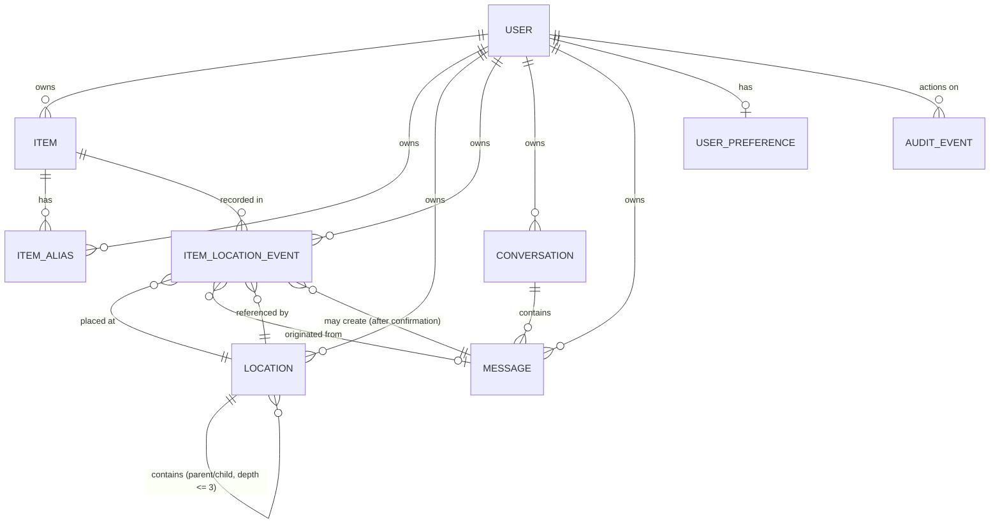

# Database Schema — SmartHomeAI

| Field | Value |
|---|---|
| Version | 0.1.0 |
| Status | Draft for review |
| Source of truth | PostgreSQL 16 on **Supabase** (managed, pooled runtime URL + direct migration URL) — D2 (amended 2026-10-17 by ADR-005); Docker/native local Postgres is an optional fallback only |
| Normative artifact | [`prisma/schema.prisma`](../../prisma/schema.prisma) — this document mirrors it and adds constraints Prisma cannot express |

---

## 1. Design principles

1. **Relational and explicit.** Ownership (`ownerId`) is on every user-scoped table so
   every query can be scoped in one predicate (FR-012).
2. **Append-only memory.** `ItemLocationEvent` is never updated or deleted by application
   features; corrections append a new event (FR-004, BR-06).
3. **Soft delete + retention.** Items are soft-deleted (`deletedAt`); hard deletion happens
   only via retention/purge jobs (BR-07, FR-014).
4. **Derived, not duplicated.** "Last recorded location" is derived from the newest event,
   not stored on `Item` (no second source of truth).
5. **Timestamps carry meaning.** `occurredAt` (when the user says it happened) is distinct
   from `recordedAt`/`createdAt` (when the system stored it) (FR-004).
6. **Naming.** Tables/columns are snake_case in the database (`@@map`/`@map`); Prisma
   models are PascalCase.
7. **Opaque ids are text.** `users.id` is the identity provider's `sub` (or a local
   dev id) — stored as TEXT, and every FK referencing it is TEXT too (Postgres
   requires FK column types to match exactly). UUID columns are used only for keys
   this system generates itself.

## 2. Entity-relationship diagram



## 3. Entities

For each entity: fields, keys, nullability, indexes, constraints, ownership, deletion
behavior. `PK` = primary key, `FK` = foreign key, `U` = unique constraint.

### 3.1 `users`

Maps the authenticated identity (Supabase Auth `sub`, ADR-005) to application data.

| Column | Type | Null | Constraints | Notes |
|---|---|---|---|---|
| `id` | text | No | PK | Opaque identity-provider id (Supabase Auth `sub`, or `dev_*` locally); created on first authenticated request. TEXT because subs are opaque strings — all FKs to this column must also be text (Postgres requires exact FK type match) |
| `email` | text | No | U | From the identity provider; used for display/export only |
| `display_name` | varchar(120) | Yes | | |
| `created_at` | timestamptz | No | default now() | |
| `updated_at` | timestamptz | No | | Maintained by Prisma `@updatedAt` |
| `deleted_at` | timestamptz | Yes | | Set during account-deletion grace period (FR-014); blocks sign-in at middleware |

- **Ownership:** n/a (is the owner).
- **Deletion:** hard delete cascades to all owned rows (see §4). Account deletion first
  soft-deletes, then purges after the 7-day grace period (BR-08).

### 3.2 `items`

| Column | Type | Null | Constraints | Notes |
|---|---|---|---|---|
| `id` | uuid | No | PK | generated uuid |
| `owner_id` | text | No | FK → users.id (CASCADE), indexed | |
| `name` | varchar(120) | No | | trimmed; FR-002 validation |
| `description` | text | Yes | | |
| `category` | varchar(60) | Yes | | free text, normalized lowercase (no taxonomy in MVP) |
| `created_via` | enum(`USER`,`ASSISTANT`) | No | default `USER` | provenance |
| `created_at` / `updated_at` | timestamptz | No | | |
| `archived_at` | timestamptz | Yes | | archive flag (FR-016) |
| `deleted_at` | timestamptz | Yes | | soft delete (FR-016) |

- **Indexes:** `(owner_id, deleted_at, archived_at)` for default list scoping;
  `(owner_id, name)` for lookup/duplicate warning; GIN trgm on `lower(name)` and a
  generated `search_tsv` column (§5, added via SQL migration).
- **Constraints:** app-level duplicate-name warning (allowed, BR-03).
- **Deletion:** soft delete; `CASCADE` from `users` on account purge.

### 3.3 `item_aliases` (schema ready in MVP; feature is P1 FR-019)

| Column | Type | Null | Constraints | Notes |
|---|---|---|---|---|
| `id` | uuid | No | PK | |
| `owner_id` | text | No | FK → users (CASCADE), indexed | denormalized for scoping |
| `item_id` | uuid | No | FK → items (CASCADE), indexed | |
| `alias` | varchar(120) | No | | as entered |
| `normalized_alias` | varchar(120) | No | U `(owner_id, normalized_alias)` | lowercase+trimmed; one alias maps to one item per owner |
| `created_at` | timestamptz | No | | |

- **Indexes:** `(normalized_alias)` for retrieval joins; GIN trgm on `lower(normalized_alias)` (§5).

### 3.4 `locations`

| Column | Type | Null | Constraints | Notes |
|---|---|---|---|---|
| `id` | uuid | No | PK | |
| `owner_id` | text | No | FK → users (CASCADE), indexed | |
| `name` | varchar(80) | No | | trimmed |
| `description` | text | Yes | | |
| `parent_id` | uuid | Yes | FK → locations (RESTRICT), indexed | null = top-level; depth ≤ 3 (BR-04) |
| `archived_at` | timestamptz | Yes | | blocked while referenced by active items/events (BR-05, FR-017) |
| `created_at` / `updated_at` | timestamptz | No | | |

- **Indexes:** `(owner_id, archived_at)`; `(owner_id, parent_id, name)`.
- **Sibling uniqueness:** enforced in the service layer within a transaction, plus partial
  unique indexes in SQL migration V3:
  `CREATE UNIQUE INDEX ux_locations_sibling_named ON locations(owner_id, parent_id, lower(name)) WHERE parent_id IS NOT NULL AND archived_at IS NULL;`
  `CREATE UNIQUE INDEX ux_locations_sibling_root ON locations(owner_id, lower(name)) WHERE parent_id IS NULL AND archived_at IS NULL;`
- **Deletion:** locations are **archived, not deleted**, while referenced (FR-017). Hard
  delete exists only in purge contexts (`CASCADE` from users).

### 3.5 `item_location_events` — the memory (append-only)

| Column | Type | Null | Constraints | Notes |
|---|---|---|---|---|
| `id` | uuid | No | PK | |
| `owner_id` | text | No | FK → users (CASCADE), indexed | denormalized for fast scoped feeds |
| `item_id` | uuid | No | FK → items (CASCADE), indexed | |
| `location_id` | uuid | No | FK → locations (CASCADE), indexed | |
| `occurred_at` | timestamptz | No | | when the item was reportedly placed there (user-truth, may be backdated) |
| `recorded_at` | timestamptz | No | default now() | when the system stored it; never updated |
| `source` | enum(`MANUAL`,`ASSISTANT`) | No | default `MANUAL` | provenance (FR-004) |
| `confidence` | enum(`CONFIRMED`,`INFERRED`) | No | default `CONFIRMED` | `INFERRED` reserved for future auto-tracking (FR-029); UI must display it distinctly |
| `note` | varchar(300) | Yes | | optional user note |
| `message_id` | uuid | Yes | FK → messages (SET NULL) | originating assistant message when created via assistant |

- **Indexes:** `(item_id, occurred_at DESC)` (item timeline + "last location" derivation);
  `(owner_id, recorded_at DESC)` (activity feed, dashboard); GIN trgm on `lower(note)` not
  needed — notes are not searched in MVP.
- **Invariants (enforced in service layer + tests):**
  1. No `UPDATE` statements target this table in application code (UT-004-1 greps/reviews; QA verifies).
  2. `occurred_at` ≤ now() + 5 min skew (FR-004).
  3. "Last recorded location" of item X = event with max(`occurred_at`) among the owner's events for X.
- **Deletion:** only via account purge (`CASCADE`). Retention jobs never touch events of
  live accounts; item soft-delete hides events from retrieval but preserves them for restore.

### 3.6 `conversations` / `messages`

| Column (conversations) | Type | Null | Constraints |
|---|---|---|---|
| `id` | uuid | No | PK |
| `owner_id` | text | No | FK → users (CASCADE) |
| `title` | varchar(120) | Yes | derived from first message (truncated) |
| `status` | enum(`ACTIVE`,`ARCHIVED`) | No | default `ACTIVE` |
| `last_message_at` | timestamptz | Yes | updated on each message insert |
| `created_at` / `updated_at` | timestamptz | No | |

| Column (messages) | Type | Null | Constraints |
|---|---|---|---|
| `id` | uuid | No | PK |
| `conversation_id` | uuid | No | FK → conversations (CASCADE), indexed `(conversation_id, created_at)` |
| `owner_id` | text | No | FK → users (CASCADE) |
| `role` | enum(`USER`,`ASSISTANT`) | No | |
| `content` | text | No | ≤ 2000 chars user / ≤ 4000 chars assistant (app-level) |
| `intent` | varchar(40) | Yes | classified intent (metadata) |
| `pending_action` | jsonb | Yes | structured write proposal + `expiresAt` (FR-024) |
| `status` | enum(`COMPLETE`,`PENDING_ACTION`,`FALLBACK`,`ERROR`) | No | |
| `model` | varchar(80) | Yes | provider model id (metadata) |
| `latency_ms`, `prompt_tokens`, `completion_tokens` | int | Yes | operational metadata |
| `created_at` | timestamptz | No | |

- **Privacy:** conversation **content** never appears in application logs (only the metadata
  columns above) — BR-09, FR-023. User-initiated conversation deletion hard-deletes its
  messages immediately (privacy control).
- **Deletion:** `CASCADE` from conversation/user.

### 3.7 `user_preferences`

| Column | Type | Null | Constraints |
|---|---|---|---|
| `user_id` | text | No | PK (= users.id), FK (CASCADE) |
| `theme` | enum(`LIGHT`,`DARK`,`SYSTEM`) | No | default `LIGHT` |
| `locale` | varchar(10) | Yes | reserved; English only in MVP |
| `show_suggested_questions` | boolean | No | default true |
| `created_at` / `updated_at` | timestamptz | No | |

### 3.8 `audit_events`

Justified (per spec §11) for: account deletion lifecycle, data export, assistant write
confirmations, and permission-relevant anomalies. Deliberately minimal.

| Column | Type | Null | Constraints |
|---|---|---|---|
| `id` | uuid | No | PK |
| `owner_id` | text | Yes | FK (CASCADE); null = system event |
| `actor_type` | enum(`USER`,`SYSTEM`) | No | |
| `action` | varchar(60) | No | e.g. `ACCOUNT_DELETE_REQUESTED`, `DATA_EXPORTED`, `ITEM_DELETED`, `ASSISTANT_WRITE_CONFIRMED` |
| `target_type` / `target_id` | varchar | Yes | |
| `metadata` | jsonb | Yes | non-content only (counts, ids, action types) |
| `ip_hash` | varchar(64) | Yes | salted hash — never raw IP |
| `created_at` | timestamptz | No | |

- **Indexes:** `(owner_id, created_at DESC)`, `(action, created_at DESC)`.
- **Owner FK:** `ON DELETE SET NULL` — on account purge the system trail is kept, anonymized (BR-08).
- **Retention:** 12 months, then deleted by retention job (BR-08). PII-free by design.

## 4. Cascade and deletion summary

| Event | Effect |
|---|---|
| Item soft delete (user) | `deleted_at` set; excluded from lists/search/assistant retrieval; restorable ≤ 30 days; then purge job hard-deletes the item (events cascade) |
| Item archive (user) | `archived_at` set; hidden from default views; events retained |
| Location archive (user) | blocked if referenced (FR-017); else `archived_at` set; pickers hide archived |
| Location hard delete | only in purge contexts; `item_location_events.location_id` cascades |
| Conversation delete (user) | hard delete of conversation + messages (privacy); events created from those messages keep `message_id = NULL` |
| Account deletion (user) | soft delete → 7-day grace → purge: `users` row delete cascades to all owned rows; `audit_events.owner_id` is set to NULL (anonymized) and the rows are retained (BR-08) |

## 5. Search implementation (D6 — no vectors in MVP)

Added by SQL migration `000002_search/migration.sql` (V2; Prisma cannot express these declaratively):

```sql
CREATE EXTENSION IF NOT EXISTS pg_trgm;

-- Full-text vector on items ('simple' dictionary: names/categories are not prose)
ALTER TABLE items
  ADD COLUMN search_tsv tsvector
  GENERATED ALWAYS AS (
    to_tsvector('simple',
      coalesce(name,'') || ' ' || coalesce(description,'') || ' ' || coalesce(category,''))
  ) STORED;

CREATE INDEX idx_items_search_tsv ON items USING GIN (search_tsv);
CREATE INDEX idx_items_name_trgm  ON items USING GIN (lower(name) gin_trgm_ops);
CREATE INDEX idx_locations_name_trgm ON locations USING GIN (lower(name) gin_trgm_ops);
CREATE INDEX idx_aliases_trgm ON item_aliases USING GIN (lower(normalized_alias) gin_trgm_ops);
```

Ranking (FR-005, FR-020): exact normalized match → prefix (`ILIKE 'q%'`) → trigram
similarity (`similarity()`, threshold ~0.3) → `ts_rank_cd` on `search_tsv`; archived/deleted
items demoted/excluded. This is implemented in one repository module (`search.repo`) so the
ranking can evolve without touching callers.

## 6. Migration strategy

1. **Tooling:** Prisma Migrate. Local: `npx prisma migrate dev`; cloud: `prisma migrate deploy`
   executed in the deployment pipeline **before** the new app version receives traffic
   (expand phase), never from developer laptops against cloud databases.
2. **Migration files:** numbered, forward-only, using the Prisma folder convention
   (`<seq>_<name>/migration.sql`): `000001_init` (V1 — generated from the schema),
   `000002_search` (V2), `000003_location_uniques` (V3). Raw SQL migrations are
   committed and reviewed.
3. **Expand-contract:** breaking changes (column rename/type change) are done in two
   releases: add new + dual-write/backfill → switch reads → drop old (see DEPLOYMENT.md §6).
4. **Rollback:** migrations are not auto-reversed in production; rollback = redeploy the
   previous app version (compatible with the expanded schema) and, if necessary, restore
   from the automated backup (DISASTER_RECOVERY.md).
5. **Seeds:** a deterministic dev seed (`prisma/seed.ts`, Phase 3) creates a demo user,
   6 locations, 10 items, and 15 events — never runs outside `local`/`dev`.
6. **Validation:** `npx prisma validate` and `npx prisma migrate diff --from-schema-datamodel --to-migrations`-style drift checks run in CI (task T-021).

## 7. Environment isolation

| Env | Database | Notes |
|---|---|---|
| local | Supabase Free project (primary); optional fallback: Docker `postgres:16` volume or native PG 16 (Docker not installed on the inspected machine) | disposable; recreated from migrations + seed |
| dev (shared test) | Supabase Free project | no production data |
| staging | Supabase Free project (separate project; Free tier = 2 active projects) | production-like, synthetic data only |
| production | Supabase Free for MVP; **Pro upgrade at launch** (daily backups, 7-day retention, never pauses) | no automatic backups on Free — scheduled `supabase db dump` exports (DISASTER_RECOVERY.md) |

No production data is ever copied into non-production environments (BR-11).
