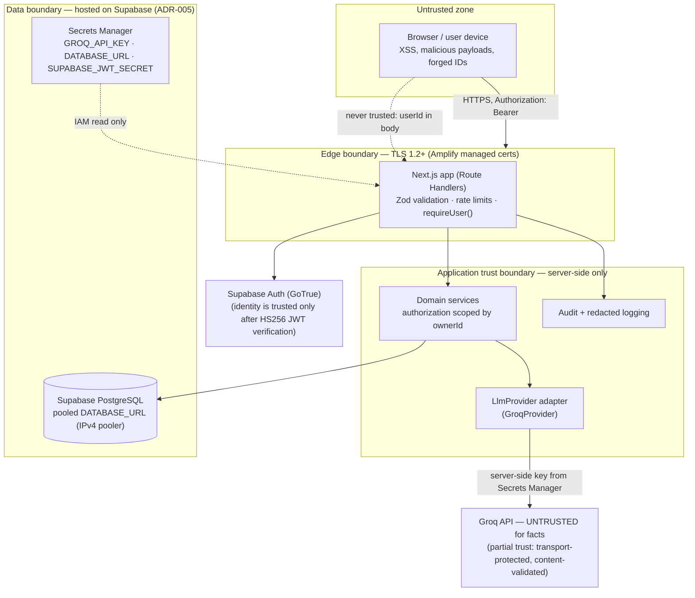

# Security — SmartHomeAI

| Field | Value |
|---|---|
| Version | 0.1.0 |
| Status | Draft for review |
| Date | 2026-10-15 |
| Scope | Application + cloud controls for the MVP; owners: Security Review Agent (T-064) + AWS Solutions Architect |
| Related requirements | NFR-004 (TLS/secrets), NFR-005 (data isolation), FR-012, FR-014, FR-023, FR-024 |

> Everything AWS-related here is **proposed, not provisioned**. Security claims are design
> intentions to be verified by tests (T-060, T-063, T-064); no penetration test, audit, or
> certification has been performed.

---

## 1. Threat model

### 1.1 Assets

| Asset | Sensitivity | Where it lives |
|---|---|---|
| Personal inventory data (items, locations, append-only events) | High — reveals home layout and possessions | PostgreSQL (Supabase hosted — pooled transaction-mode `DATABASE_URL`) |
| Assistant conversations (user text + replies) | High — free-form personal content | PostgreSQL; never in logs (BR-09) |
| Credentials (Supabase Auth passwords, session/JWT state) | Critical | Supabase Auth (GoTrue) — passwords handled by GoTrue, never our code; `SUPABASE_JWT_SECRET` stays server-side |
| `GROQ_API_KEY` | Critical — third-party secret, money + data risk | Secrets Manager (cloud), `.env` (local only) |
| `DATABASE_URL` (incl. password) | Critical — full DB access | Secrets Manager (cloud), `.env` (local only) |
| Audit events / logs | Medium — metadata, must stay redacted | CloudWatch Logs, `audit_events` table |

### 1.2 Actors

| Actor | Capability assumed | Primary mitigation |
|---|---|---|
| **Anonymous attacker** | Public internet access to the web origin | TLS everywhere; no unauthenticated data endpoints (only `GET /api/health`); rate limits; input validation; Supabase Auth rate limiting |
| **Authenticated malicious user** | Valid account, may try other users' data | Server-side authorization: `ownerId` from verified token, repository scoping, 404 for not-owned (FR-012, IT-012-1 matrix) |
| **Prompt injection via stored content** | Crafts item/location names or messages that try to become instructions | S-3/S-4/S-5 rules: untrusted-data delimiting, no tool use, authorization outside the LLM, confirmed writes (§8) |
| **Supply chain** | Malicious/compromised npm dependency or CI step | Lockfile, `npm audit` + secret scanning in CI (T-063), minimal dependency set, PR-reviewed changes |
| **Over-privileged IAM / insider** | AWS console or key access | Least-privilege roles (AWS_ARCHITECTURE §6), tags + `ManagedBy=CDK`, single account with env tags, no shared root |

### 1.3 Out of scope for the MVP threat model

Physical data-center threats (AWS responsibility model), nation-state actors, application-layer
DDoS beyond rate limiting (WAF deferred — R-11), and multi-tenant isolation beyond
owner-scoping (the product is per-account, not per-org).

---

## 2. Trust boundaries

Rules at each boundary: the browser is **never** a source of identity; Groq is **never** a
source of facts (FR-007/FR-010); secrets never cross into client bundles or logs.

---

## 3. Controls mapped to requirements

### 3.1 Authentication — Supabase Auth (D5, ADR-005)

- **Chosen:** Supabase Auth (GoTrue); the browser completes sign-up, login, recovery, and
  email confirmation through our `/api/auth/*` proxy routes (so the session cookie stays
  httpOnly); the app verifies the JWT **server-side** — HS256 with `SUPABASE_JWT_SECRET`,
  issuer `<SUPABASE_URL>/auth/v1`, audience `authenticated`, expiry — and derives
  `ownerId = sub` (FR-012). Deleted accounts are rejected at `requireUser()`.
- **Why:** managed flows and recovery emails beat hand-rolled auth for a small team;
  Supabase Auth Free includes 50,000 MAU (ADR-005); passwords are handled by GoTrue —
  never our code.
- **Dev mode:** `AUTH_MODE=dev` provides local email-only login for offline development
  and is **refused in production**.
- **Email delivery caveat:** on Free, Supabase's built-in email service is rate-limited
  (~2–3 emails/hour); mitigation = configure custom SMTP (staging/prod) or disable
  confirmations in dev environments (R-10).
- **Documented alternative (reversible decision):** *Auth.js + Prisma-backed sessions +
  a dedicated email service for verification/recovery flows.* Adopted **only if** the
  Supabase Auth integration proves infeasible at the **T-023 checkpoint** ("Supabase Auth
  UX acceptable in a real browser?", IMPLEMENTATION_PLAN assumptions A-7). Because every
  handler talks to identity only through the narrow `requireUser()` verification layer in
  `src/lib/auth/`, swapping the provider changes that module + auth pages, not the
  services or repositories.
- MFA: TOTP is **optional** via Supabase Auth for users who enable it; not required by
  default (§11 non-goals).

### 3.2 Authorization — server-side, always (FR-012)

- `ownerId` comes only from the verified token — never from bodies, queries, or path params.
- Every repository query for user data requires an `ownerId` argument (schema/design in
  [SYSTEM_ARCHITECTURE.md](SYSTEM_ARCHITECTURE.md) §2); "not mine" responds **404
  `NOT_FOUND`**, indistinguishable from "doesn't exist" ([API_SPEC.md](API_SPEC.md) §2).
- Assistant retrieval and write paths use identical scoping (S-4).
- Enforced and proven by the ownership matrix **IT-012-1** (every endpoint × cross-user
  negative path, T-037) and E2E-012-1.
- Assistant writes additionally require explicit confirmation with 24 h expiry (FR-024);
  pending actions are looked up scoped by owner.
- **Postgres RLS is NOT relied upon in the MVP:** Prisma (via the service layer) owns all
  data access and `ownerId` scoping (FR-012); enabling Supabase row-level security is an
  optional hardening step later, not a current control.

### 3.3 Secrets

| Environment | Secret storage | Rules |
|---|---|---|
| Local dev | `.env` (gitignored), documented placeholders in `.env.example` | Never commit real values; rotate if exposed |
| Staging / production | **AWS Secrets Manager** (`GROQ_API_KEY`, `DATABASE_URL`, `DIRECT_URL`, `SUPABASE_JWT_SECRET`) read via IAM (T-070/T-071) | No plaintext env vars in the Amplify console beyond a deploy-time fetch; rotation cadence: **quarterly** (AWS_ARCHITECTURE, ADR-003) |
| Anywhere | — | No `NEXT_PUBLIC_*` secrets (client bundles are public); service credentials (incl. `SUPABASE_JWT_SECRET`) never via `NEXT_PUBLIC_*`; the Supabase anon key *may* be public but we do not need it client-side; Supabase URL/anon key are injected via env/Secrets Manager like other config; no secrets in error messages, logs, or CI output |

- CI **secret scanning** (T-063, e.g. gitleaks) plus dependency audit gates every PR.
- IAM least privilege for secret reads only on `smarthomeai-*` resources
  (AWS_ARCHITECTURE §6).

### 3.4 Transport

TLS 1.2+ everywhere: Amplify-managed ACM certificates terminate HTTPS on the app origin;
Groq calls are HTTPS from the server; database traffic runs over TLS from the server to
Supabase's pooled endpoint (**recommended to enforce SSL on the connection — assumption on
driver settings to confirm in T-070**). No plaintext HTTP entry points; HSTS header set (T-060).

### 3.5 Input validation (Zod at every boundary)

- Route handlers parse body/query/params with shared Zod schemas; invalid → 400
  `VALIDATION_ERROR` with field paths (API_SPEC §2).
- Size limits: message ≤ 2,000 chars, body ≤ 32 KB (413 otherwise), pagination caps
  (limit ≤ 100), name/description length constraints mirrored client-side for UX only.
- Assistant structured outputs are re-validated with Zod after the LLM (one repair retry,
  then fallback) — model output is untrusted input.

### 3.6 SQL injection

Prisma parameterization for all queries; **no** string-built SQL. The only raw SQL is in
reviewed, forward-only migrations (`DATABASE_SCHEMA.md` §5/§6) which contain no user input.
Search normalizes user queries (length bounds, `ILIKE`-escaping of `%`/`_`, no raw
`tsquery` concatenation) inside `search.repo`.

### 3.7 XSS

React escapes by default; assistant output is rendered as **plain text + links only** —
`dangerouslySetInnerHTML` is prohibited for model output (AI_ARCHITECTURE §4: HTML escaped
by the rendering layer). CSP and related security headers added in T-060.

### 3.8 CSRF

- The httpOnly session cookie set by our `/api/auth/*` proxy (Supabase Auth) sets
  `SameSite` + `Secure` attributes; state-changing requests additionally require the
  `Authorization: Bearer` header, which cross-site forms cannot attach.
- Origin/Referer checks on state-changing POSTs as defense in depth (T-060 posture review).

### 3.9 Rate limiting

Per-user token buckets per route class — assistant 20/min, writes 60/min, reads 120/min,
plus BR-12 daily assistant cap (100/day) → 429 `RATE_LIMITED` with `Retry-After`
(API_SPEC §1). Documented as **best-effort in-memory** on shared hosting (multi-instance
counters are per instance); revisit with a shared store only if abuse appears.

### 3.10 Abuse prevention

- Assistant daily/minute caps (BR-12) bound LLM spend and spam writes.
- `pendingAction` expires after 24 h and is **never auto-executed** (FR-024).
- Payload/length limits (§3.5) and message-size clamps stop storage-flooding.
- Audit events on sensitive actions (§7) make abuse detectable.

### 3.11 Prompt injection defenses (AI safety S-1…S-10)

| Control | Implementation |
|---|---|
| Stored names, aliases, locations, and user messages are **untrusted data** | Delimited in prompts, never interpreted as instructions (S-3) |
| Model cannot invoke tools, run SQL, or fetch other users' data | Pipeline retrieves deterministically under `ownerId` scope; adapter interface exposes only completion (S-4, S-5) |
| No writes without explicit user confirmation | `pendingAction` + confirm/cancel endpoint, 24 h expiry (S-6, FR-024) |
| Authorization lives outside the LLM | Service layer (§3.2) — the model receives no capability tokens |
| Injection evaluation | Injection cases in the AI evaluation suite (`prompts/EVALUATION_CASES.md`, run at T-064/AIE gates) |
| Output hygiene | Grounding validation (FR-010) strips unknown IDs; no chain-of-thought exposure (S-9) |

### 3.12 CI controls

PR pipeline ([DEPLOYMENT.md](DEPLOYMENT.md) §3): lint → typecheck → unit + integration tests
→ `prisma validate` → build → **secret scan (T-063)** → **dependency audit (T-063)**;
branch protection + review checklist (T-066). Security review gate T-064 must report **zero
open high/critical findings** before release (T-075).

### 3.13 Audit events (BR-08)

`audit_events` records: account deletion request/complete, data export, assistant write
confirmations, permission-relevant anomalies (DATABASE_SCHEMA §3.8). PII-minimized by design
(`ip_hash` salted, metadata-only JSON). **Retention: 12 months**, then trimmed by the
retention job (T-088).

### 3.14 Log redaction rules

- **Allowlist logging only:** `requestId`, `route`, `method`, `statusCode`, `latencyMs`,
  `ownerId` *hash* (or omit), `outcome`, counts, IDs of actions — never message content,
  item names, location names, emails, tokens, or provider payloads (S-10, BR-09).
- Levels via `LOG_LEVEL`; a central logger applies redaction before serialization, so ad-hoc
  `console.log` of objects is a review finding.
- Enforced by unit test **UT-023-1** (log redaction guard, FUNCTIONAL_REQUIREMENTS FR-023) —
  a failing redaction test blocks merge.

### 3.15 Data deletion and lifecycle (FR-014, BR-07/BR-08)

| Data | User action | Timeline | Mechanism |
|---|---|---|---|
| Item | Delete (soft) | Restorable ≤ 30 days, then purge | `deleted_at` + retention job (T-088) |
| Conversation + messages | Delete | **Immediate hard delete** (privacy, FR-023) | CASCADE delete |
| Account (all owned rows) | Settings → Delete | Soft delete → **7-day grace** → full purge; audit rows anonymized | FR-014 flow + purge job; failure retried + alarmed (OBSERVABILITY) |
| Audit events | System | 12-month trim | Retention job (BR-08) |
| Backups containing deleted data | — | Supabase backups age out per plan (Free: no automatic backups — scheduled `supabase db dump` exports only; Pro: daily backups, 7-day retention) | [DISASTER_RECOVERY.md](DISASTER_RECOVERY.md) — **disclosed**: deletion is not "instant" in backups |

### 3.16 Environment separation (BR-11)

No production data outside production: separate databases per environment, separate
Supabase projects for staging/production (Free tier allows 2 active projects), tags enforce
inventory, seeds run only on `local`/`dev`
(DATABASE_SCHEMA §7).

### 3.17 Budget alerts (cost as a security control)

AWS Budgets alarms at 80%/100% of the ≤ USD 25/mo threshold (C-4, T-074) — cost spikes are
treated as an operational incident (crypto-mining/abuse signal).

---

## 4. Incident response

| Phase | Actions |
|---|---|
| **Detection** | CloudWatch alarms (error rate, AI fallback rate, app 5xx — [OBSERVABILITY.md](OBSERVABILITY.md)); database metrics from the Supabase dashboard; budget alarms; user report; CI security gate |
| **Severity** | **S1**: credential/data exposure or cross-user access suspected · **S2**: outage/degradation > 30 min or data-loss risk · **S3**: single-feature defect with workaround |
| **Containment (S1)** | Rotate `GROQ_API_KEY` (Secrets Manager + revoke at Groq) · rotate `DATABASE_URL`/`DIRECT_URL` password and `SUPABASE_JWT_SECRET` (then re-inject via Secrets Manager) · revoke the affected user's sessions / rotate Supabase Auth keys via the Supabase admin path if tokens are suspect · disable the assistant feature flag if prompt abuse is active · if DB compromise suspected: restore from the latest scheduled dump into a clean project |
| **Recovery** | Redeploy known-good build; restore from backup if data is damaged ([DISASTER_RECOVERY.md](DISASTER_RECOVERY.md)); verify with the T-072 smoke path |
| **Communication** | Notify affected users if their data was exposed; record the incident with timeline; update this document and RISKS |
| **Post-incident** | Root cause + action items tracked to closure at T-064 review cadence |

---

## 5. Security non-goals for the MVP

- **No penetration-test claim** — none has been performed; T-064 is a design/prompt/injection
  review, not a pentest.
- **No SOC 2 / ISO 27001 / compliance certification** — out of scope for an MVP with no
  enterprise customers.
- **No MFA-by-default** — TOTP remains optional via Supabase Auth; enforced MFA is a future toggle.
- **No WAF at the edge** — deferred (R-11), compensating controls in §3.9/§3.5.
- **No bug-bounty program, no dedicated SOC, no WAF/rate-limit shared store** until abuse or
  scale justifies them.

---

## Related documents

- [AWS_ARCHITECTURE.md](AWS_ARCHITECTURE.md) — IAM, network, secrets services
- [AI_ARCHITECTURE.md](AI_ARCHITECTURE.md) — S-1…S-10 safety rules, fallback
- [API_SPEC.md](API_SPEC.md) — error envelope, rate limits
- [OBSERVABILITY.md](OBSERVABILITY.md) — logging/alerting detail
- [DEPLOYMENT.md](DEPLOYMENT.md) — CI scanning gates
- [adr/ADR-004-deployment.md](adr/ADR-004-deployment.md) — deployment decision (D4/D5; auth superseded by ADR-005)
- [adr/ADR-005-supabase.md](adr/ADR-005-supabase.md) — Supabase platform: database + auth decisions (D2/D4/D5)
