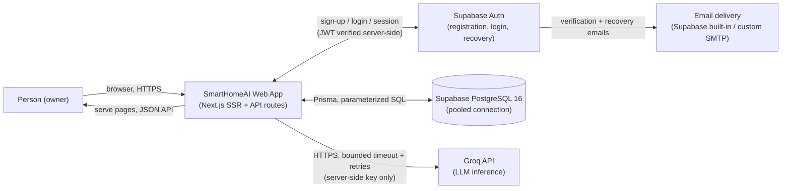
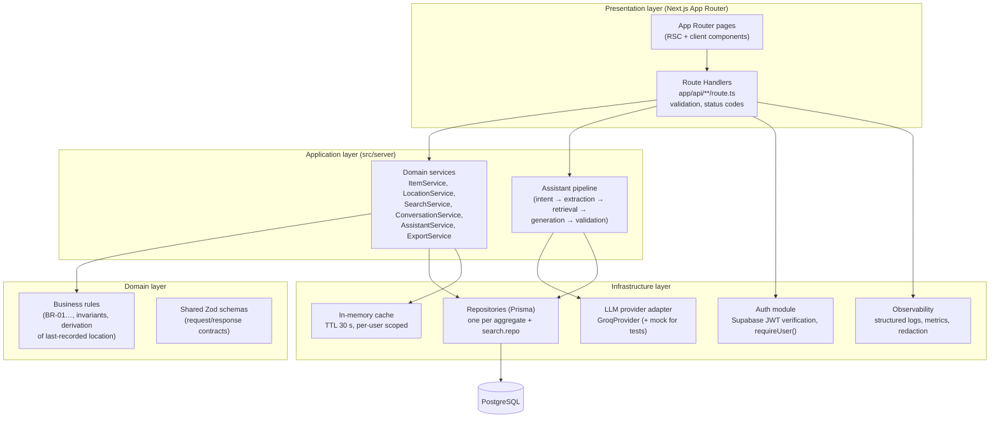
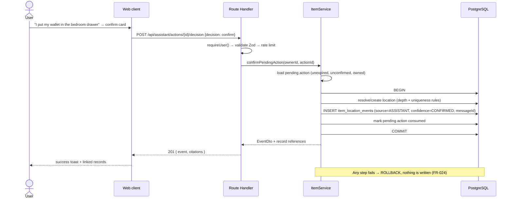

# System Architecture — SmartHomeAI

| Field | Value |
|---|---|
| Version | 0.1.0 |
| Status | Draft for review |
| Decision | **Modular monolith on Next.js** (ADR-001); PostgreSQL via Prisma (ADR-002), hosted on **Supabase** (ADR-005); Groq behind an adapter (ADR-003); Amplify Hosting + CDK (ADR-004); **Supabase Auth** for authentication (ADR-005, amends D5) |

---

## 1. System context

SmartHomeAI is a single-user-per-account web application. The user interacts with a
responsive dashboard; the application talks to one external AI provider (Groq), one
managed database (Supabase — PostgreSQL 16, ADR-005), and Supabase Auth for
authentication (ADR-005, amends D5).



**Trust boundaries:** the browser is untrusted; every protected operation is authorized
server-side against the verified Supabase Auth token (FR-012). Groq is untrusted for *facts* —
it explains retrieved records, it never supplies them (FR-007/FR-010).

## 2. Application components (modular monolith)

One deployable. Modules have explicit responsibilities and one-directional dependencies
(calls point downward only):



**Layering rules** (enforced by ESLint import boundaries + review):

1. `app/` (pages) never imports repositories or Prisma directly — only typed client API
   functions in `src/client/`.
2. Route handlers stay thin: parse/validate (Zod) → call exactly one service → map result
   to HTTP. No business logic in handlers.
3. Services own transactions and authorization scoping; repositories are dumb data access,
   always requiring an `ownerId` argument for user-scoped queries.
4. Providers (Groq, Supabase, S3) are reached only through adapters with narrow interfaces,
   so FR-013/FR-004 behavior is testable with mocks.

## 3. Proposed source layout (created in Phase 2/3 — T-010, T-021)

```text
src/
├── app/                      # Next.js App Router: pages + api route handlers
│   ├── (marketing)/          # landing page
│   ├── (auth)/               # sign-in, sign-up, recovery (Supabase Auth via /api/auth/*)
│   ├── (app)/                # authenticated app shell: dashboard, inventory, assistant…
│   └── api/                  # route handlers mirroring API_SPEC.md §3
├── client/                   # typed fetch wrappers, React Query hooks, UI state
├── components/               # shared UI (shadcn/ui + custom dashboard components)
├── server/
│   ├── services/             # ItemService, LocationService, SearchService, …
│   ├── assistant/            # pipeline stages, output schemas, grounding validator
│   ├── rules/                # pure business-rule functions (no I/O)
│   └── repositories/         # Prisma data access incl. search.repo
├── lib/
│   ├── auth/                 # Supabase JWT verification, requireUser, guards
│   ├── providers/llm/        # LlmProvider interface, GroqProvider, MockProvider
│   ├── validation/           # shared Zod schemas (imported by client + server)
│   ├── observability/        # logger with redaction, metrics helpers
│   └── config/               # typed env loader (Zod-validated env)
└── generated/prisma/         # Prisma client (gitignored)
```

## 4. Request flows

### 4.1 Authenticated read (e.g. inventory page)

1. Browser requests `/inventory` with its Supabase Auth session cookie.
2. Route handler/page middleware calls `requireUser()` → verifies JWT signature (HS256,
   `SUPABASE_JWT_SECRET`) + expiry on every protected operation, resolves `ownerId = sub`.
3. Service call with `ownerId` → repository query scoped by owner → DTO.
4. Response rendered (RSC) or returned as JSON; every step logs `requestId`, route,
   latency, outcome — never content.

### 4.2 Item location update (write)



The same transactional pattern applies to UI-originated writes (source=`MANUAL`).

### 4.3 AI request flow

Sequenced in [AI_ARCHITECTURE.md](AI_ARCHITECTURE.md) §4 (intent → extraction → retrieval →
grounded generation → validation), with the fallback path for provider failure (FR-013).

## 5. Cross-cutting concerns

| Concern | Approach |
|---|---|
| **Validation** | Single source of truth: shared Zod schemas in `src/lib/validation`, used by route handlers (server) and forms (React Hook Form + zodResolver) |
| **Error handling** | Central `ApiError` hierarchy → error envelope (API_SPEC §2); unexpected errors are logged with `requestId` and returned as generic 500; no provider error text ever reaches clients |
| **Authorization** | `requireUser()` in every protected handler; repository signatures force `ownerId`; "not owned" = 404 everywhere |
| **Transactions** | Multi-write operations (confirm action, re-parent location + validate) run in `prisma.$transaction`; single-write inserts do not |
| **Caching** | Minimal and per-user: Supabase Auth JWT verified with a static HS256 secret (no key cache required), location tree (per user, 30 s TTL, invalidated on write), dashboard counts computed live (cheap at this scale). No shared caches, no cross-user cache keys |
| **Observability** | Structured JSON logs with a redaction allowlist; request IDs; operational metrics counters (see OBSERVABILITY.md). No conversation/item/location content in logs |
| **Rate limiting** | In-memory token buckets per user + route class (API_SPEC §1); documented as best-effort on multi-instance hosting; revisit with a shared store only if abuse appears |

## 6. Scaling strategy

The MVP workload is personal-scale (a user's own belongings). The design deliberately scales
by *vertical headroom*, not distribution:

1. **App:** Amplify Hosting SSR instances auto-scale horizontally; statelessness is a hard
   rule (no in-process state beyond caches that may be per-instance).
2. **Database:** Supabase Free (Nano, shared compute) → Pro (larger compute, daily
   backups, no auto-pause) upgrade path; every hot query
   is indexed (DATABASE_SCHEMA §3). Connection pooling via Prisma + bounded pool size.
3. **Assistant:** Stateless per request; bounded context keeps tokens flat as data grows
   (top-K retrieval, not full-history injection).
4. **Triggers for re-evaluation** (documented, not pre-built): > 500 concurrent users,
   > 50 ms p95 DB read latency, or rate-limit store contention → consider a shared cache /
   read replica; a real multi-tenant SaaS pivot would revisit ADR-001.

## 7. Cost implications (summary; full model in COST_ESTIMATION.md)

- One deployable on Amplify free-tier-friendly pricing (build minutes + SSR GB-hours).
- The database is $0 at MVP scale (Supabase Free tier, ADR-005); paid tier (Pro) starts at launch.
- Supabase Auth is free at MVP scale (≤ 50k MAU, ADR-005).
- Groq is variable and usage-based; token budgets are enforced by bounded contexts and a
  per-user daily assistant-message cap (BR-12).
- Deliberately **not** running: API Gateway, Lambda, ElastiCache, OpenSearch, vector DBs,
  multi-AZ — each justified as unnecessary for the MVP in AWS_ARCHITECTURE.md §6.

## 8. Backend decision recap (monolith vs separate API)

| Option | Verdict | Why |
|---|---|---|
| **Next.js Route Handlers (chosen)** | ✅ | Single deployable, shared types with the UI, one CI pipeline, transactions stay simple; ops burden minimal on Amplify |
| API Gateway + Lambda API | ❌ for MVP | Second deployment track, cold starts, distributed transactions, more IAM surface — none justified by load or team size (ADR-001) |
| ECS/Fargate + ALB service | ❌ for MVP | Full container ops for a workload Amplify handles; revisit only if SSR hosting limits bite |

If the API ever needs a second consumer, the service layer is already isolated enough to be
extracted behind API Gateway with minimal rewrite — that is the documented escape hatch, not
a current goal.
