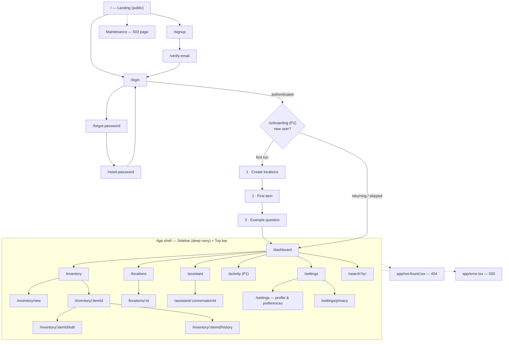
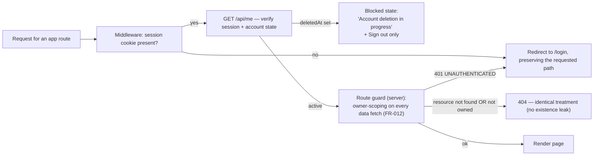

# SmartHomeAI — Information Architecture

| Field | Value |
|---|---|
| Version | 0.1.0 |
| Status | Draft for review |
| Date | 2026-10-15 |
| Owner | Design Agent |
| Scope | Sitemap, navigation model, breadcrumb rules, URL structure, permission gating |

**Companion documents:** [DESIGN_SPEC.md](DESIGN_SPEC.md) (page behavior and states) ·
[USER_FLOWS.md](USER_FLOWS.md) · [WIREFRAMES.md](WIREFRAMES.md) ·
[DESIGN_SYSTEM.md](DESIGN_SYSTEM.md) · [ACCESSIBILITY.md](ACCESSIBILITY.md).
Canonical inputs: [index.md — D7](../index.md), [PRD §8](../product/PRD.md),
[FUNCTIONAL_REQUIREMENTS](../requirements/FUNCTIONAL_REQUIREMENTS.md),
[API_SPEC](../architecture/API_SPEC.md).

---

## 1. Sitemap

**Reading rules:** solid arrows = navigation; dotted arrows = programmatic/system destinations
(error boundaries, maintenance); the `App shell` subgraph is rendered inside
`Sidebar + Top bar + Main` for every authenticated route (§2).

---

## 2. Navigation model

### 2.1 Persistent desktop sidebar (≥ 1024 px) — deep navy `--sidebar-background`

| # | Item | Route | Icon (Lucide) | State |
|---|---|---|---|---|
| 1 | Dashboard | `/dashboard` | `LayoutDashboard` | P0 |
| 2 | Inventory | `/inventory` | `Package` | P0 |
| 3 | Locations | `/locations` | `MapPin` | P0 |
| 4 | Assistant | `/assistant` | `Sparkles` | P0 |
| 5 | Activity | `/activity` | `History` | **P1 — hidden until enabled** |
| 6 | Settings | `/settings` | `Settings` | P0 |

Rules:
- Single `nav[aria-label="Primary"]`; the active item uses `aria-current="page"`, the
  `--sidebar-accent` background, and a left 3 px indicator bar (color **plus** indicator, not
  color alone).
- Collapsible to a 64 px icon rail (labels preserved for screen readers and exposed via tooltip);
  the expanded/collapsed preference is local and remembered.
- **< 1024 px the sidebar collapses into a `Sheet` drawer** opened from the top-bar menu button;
  focus is trapped while open, `Esc`/scrim closes, focus returns to the trigger.
- Product wordmark at top (custom type mark; no AWS branding per D7/PRD C-5); account summary at
  bottom is *not* duplicated — account lives in the top bar.

### 2.2 Top bar (all viewports)

| Region | Behavior |
|---|---|
| Menu button (only < 1024 px) | Opens sidebar drawer |
| **Global search** | Input submits to `/search?q=`; `/search` is prefilled from the URL; `Cmd/Ctrl+K` shortcut is a documented enhancement, not an MVP requirement |
| **Notifications slot** | Reserved layout region + `Badge` capability; **unused in MVP** (future-proof only — no notification data exists in P0/P1) |
| **Account menu** | `Avatar` trigger → dropdown: e-mail (read-only), Settings, Theme (Light/Dark/System, FR-021), Sign out |
| **Help** | `CircleHelp` icon → popover with 3 short how-to lines + link to the assistant's example questions (static content, no external docs domain invented) |

### 2.3 Contextual navigation

- **Breadcrumbs** for nested routes only (rules in
  [DESIGN_SPEC.md §5.3](DESIGN_SPEC.md#53-breadcrumb-rules)).
- **Conversations list** on `/assistant/:conversationId` (side panel ≥ 1024 px).
- **Location tree panel** on `/locations/:id`.
- **Cross-links:** assistant citations → item detail; search results → item/location detail;
  dashboard cards → inventory/activity; empty states → the page that resolves them.

### 2.4 Breadcrumb rules (summary)

Shown: `/inventory/new`, `/inventory/:itemId`, `/inventory/:itemId/edit`,
`/inventory/:itemId/history`, `/settings/privacy`. Not shown: sidebar-root pages
(`/dashboard`, `/inventory`, `/locations`, `/assistant`, `/search`, `/activity`, `/settings`),
public pages, error pages. Format `Inventory › Item name › Location history`; current crumb is
plain text with `aria-current="page"`; separators `aria-hidden`.

---

## 3. URL structure

UI routes are owned by this document (client pages); API paths are owned by
[../architecture/API_SPEC.md](../architecture/API_SPEC.md) and are listed here only where the page
depends on them.

| Route | Page ([DESIGN_SPEC](DESIGN_SPEC.md)) | Auth | Shell | Query params | Depends on API |
|---|---|---|---|---|---|
| `/` | Landing (§1.1) | public | `PublicShell` | — | — |
| `/signup` | Auth (§1.2) | public | `PublicShell` | `next?` | Supabase Auth registration (via `/api/auth/*`) |
| `/login` | Auth (§1.2) | public | `PublicShell` | `next?`, `error?` | `GET /api/me` (session check) |
| `/forgot-password` | Auth (§1.2) | public | `PublicShell` | — | Supabase Auth recovery (via `/api/auth/*`) |
| `/reset-password` | Auth (§1.2) | public | `PublicShell` | code via link | Supabase Auth recovery (via `/api/auth/*`) |
| `/verify-email` | Auth (§1.2) | public | `PublicShell` | `email?` | Supabase Auth verification (via `/api/auth/*`) |
| `/onboarding` | Onboarding (§1.3) | required (P1) | `AppShell` | `step?` | `GET/POST /api/locations`, `POST /api/items` |
| `/dashboard` | Dashboard (§1.4) | required | `AppShell` | — | dashboard summary reads (`/api/items`, events) |
| `/assistant` | Assistant (§1.5) | required | `AppShell` | `q?` (prefill composer) | `POST /api/assistant/messages` |
| `/assistant/:conversationId` | Assistant (§1.5) | required | `AppShell` | — | `GET /api/assistant/conversations/:id`, `DELETE …` |
| `/inventory` | Inventory list (§1.6) | required | `AppShell` | `q, status, category, locationId, sort, order, limit, offset` | `GET /api/items` |
| `/inventory/new` | Create item (§1.8) | required | `AppShell` | `name?` (prefill) | `POST /api/items` |
| `/inventory/:itemId` | Item detail (§1.7) | required | `AppShell` | — | `GET /api/items/:id`, `GET /api/items/:id/events` |
| `/inventory/:itemId/edit` | Edit item (§1.8) | required | `AppShell` | — | `PATCH /api/items/:id` |
| `/inventory/:itemId/history` | Location history (§1.10) | required | `AppShell` | `limit, offset` | `GET /api/items/:id/events`, `POST /api/items/:id/events` |
| `/locations` | Locations (§1.9) | required | `AppShell` | — | `GET/POST /api/locations` |
| `/locations/:id` | Locations — detail panel (§1.9) | required | `AppShell` | — | `GET /api/locations`, `PATCH /api/locations/:id`, `POST /api/locations/:id/archive` |
| `/search` | Search results (§1.11) | required | `AppShell` | `q` (required ≥ 2 chars), `type`, `limit`, `offset` | `GET /api/search` |
| `/activity` | Activity (§1.12, P1) | required | `AppShell` | `type`, `limit`, `offset` | `GET /api/activity` |
| `/settings` | Settings (§1.13) | required | `AppShell` | `tab?` | `GET/PATCH /api/me`, `GET/PATCH /api/preferences` |
| `/settings/privacy` | Settings — privacy (§1.13) | required | `AppShell` | — | `GET /api/export` (P1), `DELETE /api/me` (P1) |
| `app/not-found.tsx` | 404 (§1.14) | any | `AppShell` if in-app, else `PublicShell` | — | — |
| `app/error.tsx` | 500 (§1.14) | any | as above | — | — |
| maintenance page | Maintenance (§1.14) | public | `PublicShell` | — | `GET /api/health` |

**Next.js App Router mapping (target structure, created in Phase 2):**
`app/(public)/`, `app/(auth)/`, `app/(app)/…` route groups with a shared `layout.tsx` providing
`PublicShell` / `AppShell`; route groups do not affect URLs.

---

## 4. Permission gating

| Rule | Detail | FR |
|---|---|---|
| All application routes are behind authentication | `/onboarding`, `/dashboard`, `/assistant/**`, `/inventory/**`, `/locations/**`, `/search`, `/activity`, `/settings/**` require a valid session; middleware performs the redirect to `/login?next=<original path>` so post-login navigation returns the user to their destination | FR-001, FR-012 |
| Server-side owner scoping | Guards are defense-in-depth; every data fetch/ mutation derives `ownerId` from the verified session (never from the URL or body) — a crafted `:itemId` for another user's record returns **404**, indistinguishable from "does not exist" | FR-012 |
| Public routes when authenticated | `/`, `/signup`, `/login`, `/forgot-password`, `/reset-password`, `/verify-email` redirect an already-signed-in user to `/dashboard` (or `next`) | FR-001 |
| Deleted account (7-day grace) | Session may exist but the account is soft-deleted: every app route renders the **blocked state** — explanatory copy, no data, **Sign out** as the only action; sign-in is rejected (401 `UNAUTHENTICATED`) | FR-014 |
| Session expiry mid-session | In-flight requests surface 401 → toast "Your session expired — please sign in" → redirect `/login?next=<path>`; unsaved form input is preserved in the redirect state where feasible | FR-001 |
| Rate limiting | `429 RATE_LIMITED` renders inline with `Retry-After` (auth and assistant are the limited classes) — never a hard block of the app shell | API_SPEC §1 |
| Error/permission pages respect gating | 404/500 inside the app keep the shell (so navigation remains possible); maintenance page is public and shows no user data | FR-013 |
| AI degradation is **not** a permission state | `503 AI_UNAVAILABLE` keeps the user fully inside the app with fallback search (see [DESIGN_SPEC.md §4.4](DESIGN_SPEC.md#44-error-and-retry-fr-013-apispec-36)) | FR-013 |
