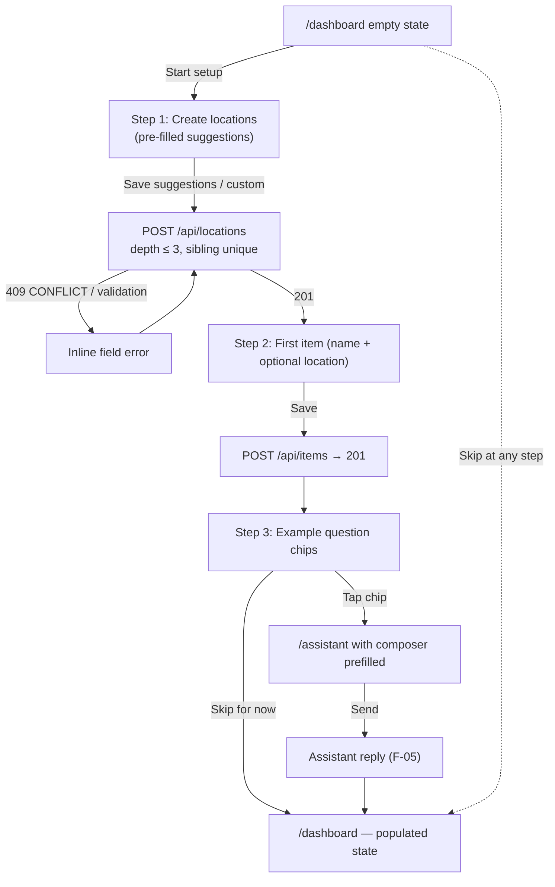
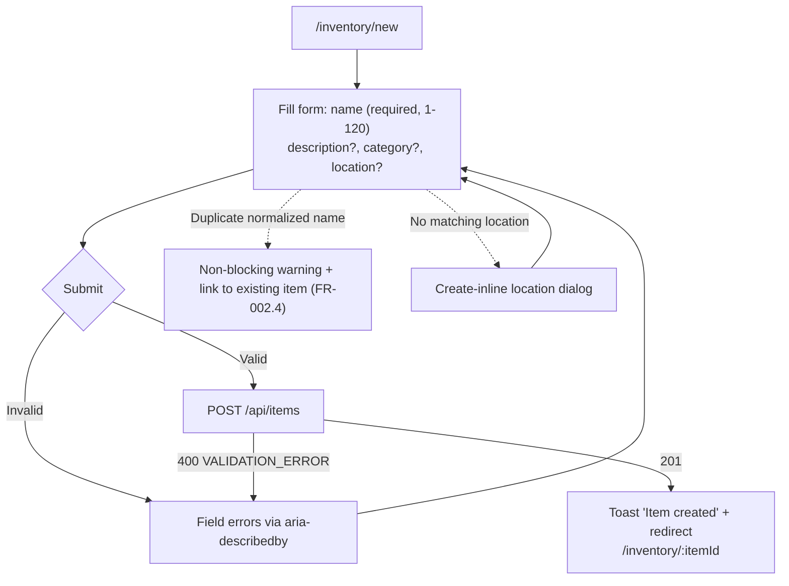
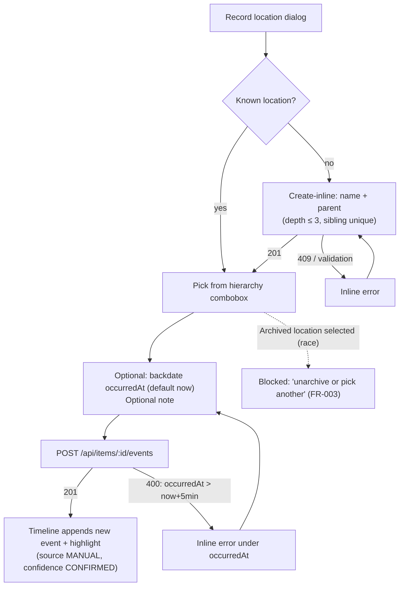
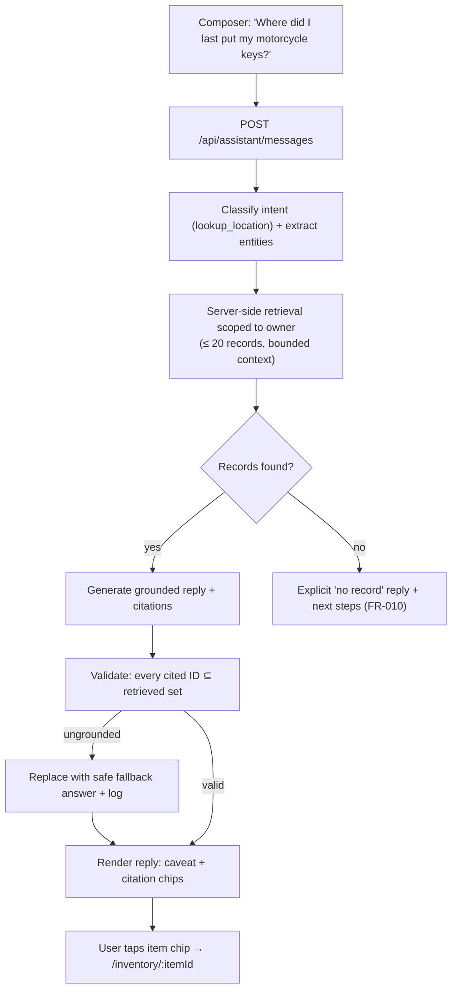
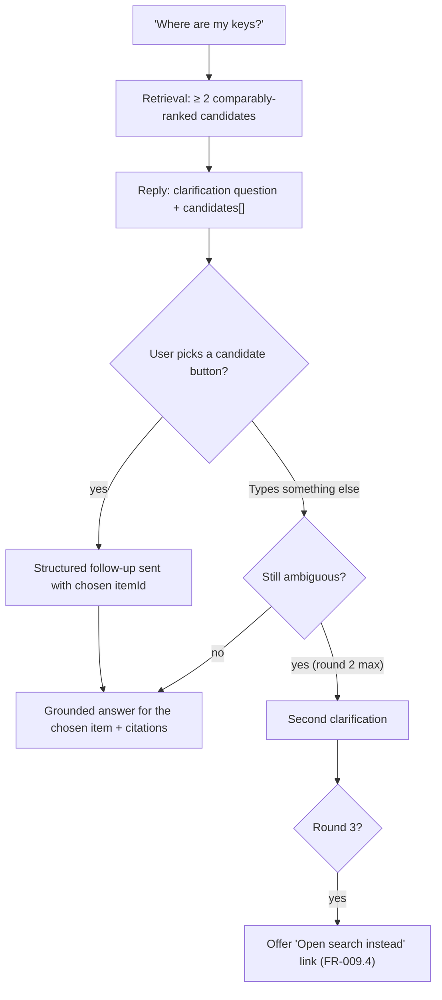
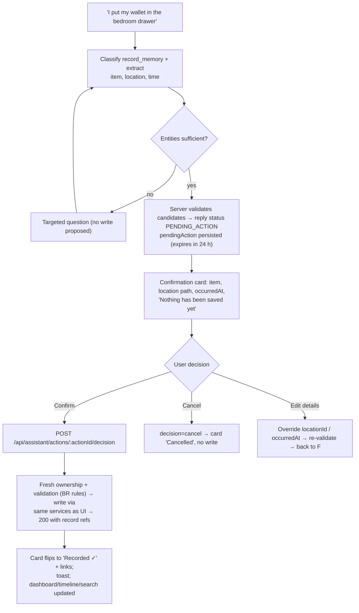
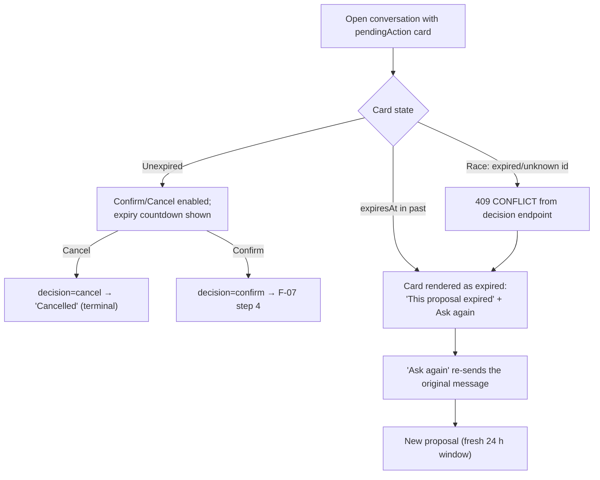
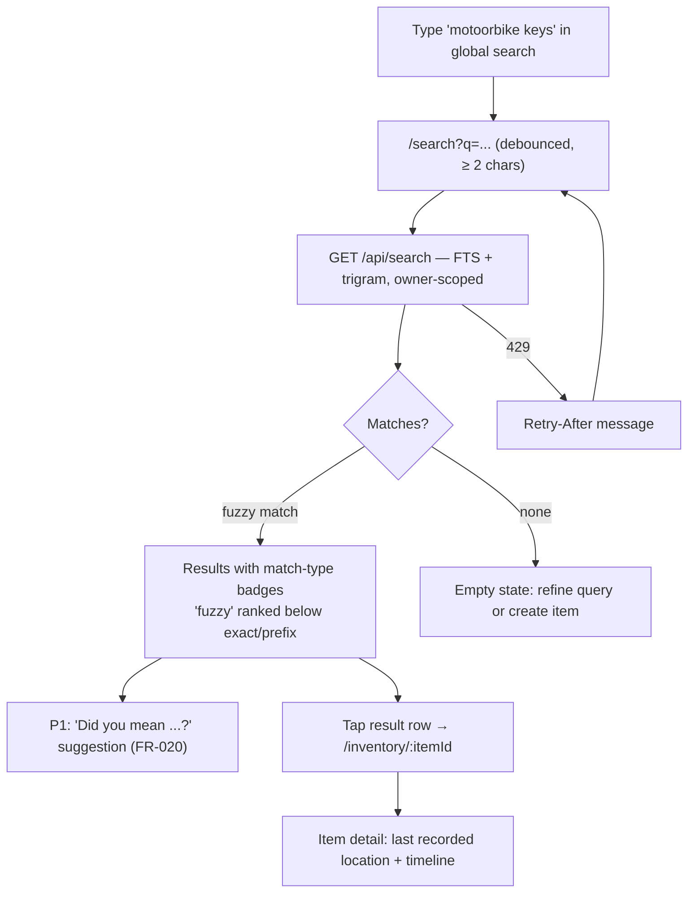
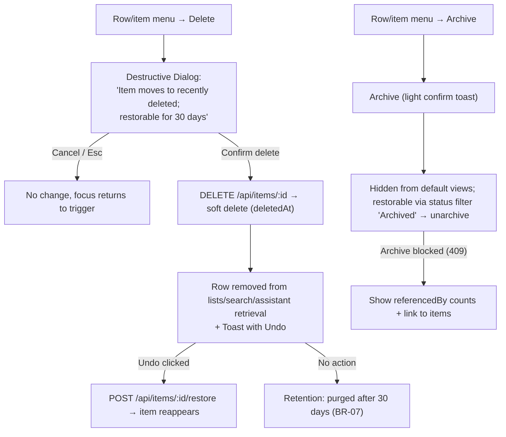
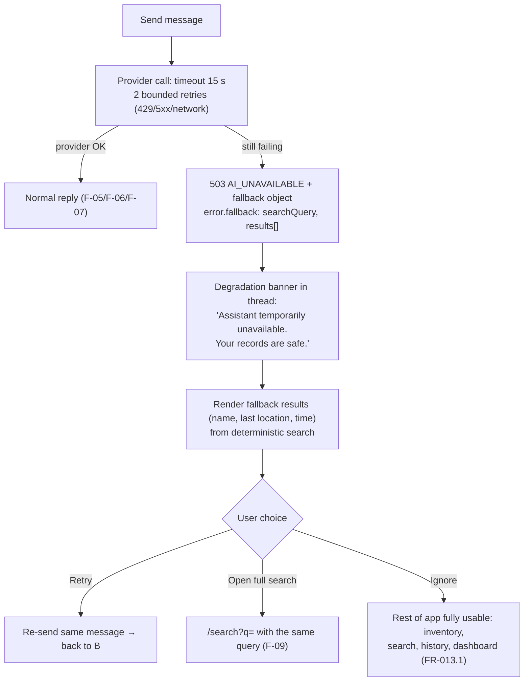

# SmartHomeAI — User Flows

| Field | Value |
|---|---|
| Version | 0.1.0 |
| Status | Draft for review |
| Date | 2026-10-15 |
| Owner | Design Agent |
| Scope | 11 flows (F-01 … F-10 plus F-11 degradation flow): Mermaid flowcharts + step tables |

**Companion documents:** [DESIGN_SPEC.md](DESIGN_SPEC.md) · [INFORMATION_ARCHITECTURE.md](INFORMATION_ARCHITECTURE.md)
· [WIREFRAMES.md](WIREFRAMES.md) · [ACCESSIBILITY.md](ACCESSIBILITY.md).
FR references use [FUNCTIONAL_REQUIREMENTS.md](../requirements/FUNCTIONAL_REQUIREMENTS.md);
API behaviors use [API_SPEC.md](../architecture/API_SPEC.md).

**Legend:** ⬜ user action · ⚙ system action · ⛔ branch/decision. Every flow assumes an
authenticated session unless stated otherwise; unauthenticated entry always redirects to
`/login?next=` first ([INFORMATION_ARCHITECTURE.md §4](INFORMATION_ARCHITECTURE.md#4-permission-gating)).

---

## F-01 — First run: sign-up → verify → sign-in → dashboard (empty state)

**Actor:** new visitor · **Entry:** `/` landing · **FR refs:** FR-001, FR-015.2 (empty state),
FR-030 (P1 hand-off)

```mermaid
flowchart TD
  A["/' Landing"] -->|"Click 'Create account'" B["/signup: e-mail + password"]
  B -->|"Submit valid"| C["Supabase Auth: confirmation e-mail sent"] --> D["/verify-email: enter code"]
  D -->|"Code valid"| E["/login: sign in"]
  D -->|"Code wrong / expired"| D2["Inline error + Resend code"] --> D
  E -->|"Credentials valid"| F{"New account?"}
  F -->|"yes"| G["/dashboard — empty state"]
  F -->|"returning"| H["/dashboard — populated"]
  G -->|"P1: 'Start setup'"| I["/onboarding (F-02)"]
  E -->|"Invalid credentials"| E2["Generic error: check e-mail and password"] --> E
```

| # | Actor action | System response |
|---|---|---|
| 1 | Open `/` | Static landing renders (no data fetch) |
| 2 | Select **Create account** → `/signup` | Form with visible labels; Zod validation on submit |
| 3 | Submit valid e-mail + password | Supabase Auth registration (via our `/api/auth/*` proxy); route to `/verify-email`; password errors are field-level |
| 4 | Enter verification code | Success → `/login`; wrong/expired code → inline error + **Resend code** (countdown) |
| 5 | Sign in with valid credentials | Session cookie issued; `GET /api/me` upserts the user row; redirect to `next` or `/dashboard` |
| 6 | Land on `/dashboard` | Zero items + zero locations → **onboarding empty state** with guided first steps (FR-015.2) |

**Branches:** invalid credentials → generic error (no account enumeration, FR-001); e-mail already
registered → Supabase Auth standard message; `429 RATE_LIMITED` → "Too many attempts" with
`Retry-After`; user already signed in visiting `/` or `/signup` → redirect `/dashboard`.
**Exits:** `/dashboard` empty state (→ F-02 on P1) · abandoned at any step (data saved server-side
only after verification) · sign-in failure loop back to `/login`.

---

## F-02 — Onboarding (P1): create locations → first item → example question

**Actor:** new user with no records · **Entry:** `/onboarding` (from F-01 empty state or first
login) · **FR refs:** FR-030, FR-017, FR-002, FR-006



| # | Actor action | System response |
|---|---|---|
| 1 | **Start setup** on the dashboard empty state | `/onboarding` step 1 with 3-step progress indicator |
| 2 | Accept/edit suggested locations, **Next** | `POST /api/locations` per entry; failures render inline (depth ≤ 3, sibling uniqueness 409) |
| 3 | Enter first item name, optional starting location, **Next** | `POST /api/items` → 201; optional initial event created when `locationId` given (API_SPEC §3.2) |
| 4 | Tap an example question chip | Navigates to `/assistant` with the composer prefilled (not auto-sent) |
| 5 | Send the question | Assistant reply with citations (F-05); user then continues freely |

**Branches:** **Skip for now** at any step → `/dashboard` and onboarding marked complete (never
repeated, FR-030); validation failures keep the user on the current step with data preserved;
location create fails with 409 → inline error listing the duplicate sibling.
**Exits:** `/assistant` after step 3 · `/dashboard` populated (skip/complete) · re-entry impossible
once completed (route redirects to `/dashboard`).

---

## F-03 — Add item via form (optional initial location)

**Actor:** signed-in user · **Entry:** `/inventory/new` (from Inventory "Add item", dashboard
quick action, or search empty state) · **FR refs:** FR-002, FR-003, FR-011



| # | Actor action | System response |
|---|---|---|
| 1 | Open `/inventory/new` (or click **Add item**) | Immediate form render (no skeleton needed) |
| 2 | Type a name; optionally description, category, starting location | Zod validates on submit; duplicate names **warn only** (FR-002.4) and never block |
| 3 | Pick a location in the `LocationPicker` combobox (searchable hierarchy) | Non-archived locations only; **"Create new location"** row opens the create-inline dialog (F-04 branch) |
| 4 | **Save** | Button spinner + disabled; `POST /api/items` → 201 |
| 5 | Success | Toast + redirect to the new item's detail page; if `locationId` was provided, the first event exists and the timeline is non-empty |

**Branches:** validation failure → inline field errors, input preserved; create-inline location
cancel → returns to the form untouched; navigating away with unsaved changes → in-app confirm
dialog; `409`/`500` → retryable banner.
**Exits:** `/inventory/:itemId` (success) · `/inventory` (cancel) · stays on form (error).

---

## F-04 — Record location for an item (picker incl. create-inline location)

**Actor:** signed-in user · **Entry:** item detail **Record location** button, dashboard quick
action "Record location", or item row action · **FR refs:** FR-003, FR-004, FR-017



| # | Actor action | System response |
|---|---|---|
| 1 | Open the dialog from item detail / dashboard / row action | `LocationPicker` loads `GET /api/locations` (non-archived) |
| 2 | Choose a location (type to filter) | Combobox announces result count; selected location shows its full path |
| 3 | (Optional) Adjust **when it happened** and add a note | `occurredAt` defaults to now; backdating allowed (FR-004.4) |
| 4 | **Save** | `POST /api/items/:id/events` → 201 (`source = MANUAL`, `confidence = CONFIRMED`, server-set) |
| 5 | Success | Dialog closes; timeline shows the appended event highlighted; toast confirms; the inventory row's "last recorded location/timestamp" now derive from this event |

**Branches:** location not found in the list → create-inline flow; create-inline 409 → inline
sibling-uniqueness error; archived location (raced) → blocked message with "unarchive or pick
another"; future `occurredAt` beyond +5 min → `VALIDATION_ERROR` inline; dialog cancel → no write.
**Exits:** item detail with appended event · `/locations` (create-inline deep path) · dialog closed
without change.

---

## F-05 — Ask the assistant "Where is X?" → grounded answer with citations (happy path)

**Actor:** signed-in user · **Entry:** `/assistant` (new conversation) or the dashboard AI entry
point · **FR refs:** FR-006, FR-007, FR-008, FR-010, FR-023



| # | Actor action | System response |
|---|---|---|
| 1 | Open `/assistant`; suggested question chips visible (empty conversation) | Composer focused; conversation not yet created |
| 2 | Type the question (≤ 2000 chars), Enter to send | User message appended; typing indicator + `aria-live` "Assistant is thinking" |
| 3 | — | Pipeline: validate → classify → extract → **retrieved server-side before any LLM call** (FR-007.1) → grounded generation |
| 4 | Receive reply | Text states the **last recorded location + `occurredAt`** with the "may have moved since" caveat (FR-008.1); `citations` render as chips |
| 5 | Tap a citation chip | Item chip → `/inventory/:itemId`; event chip → item timeline anchored `#event-<id>` |
| 6 | Continue or end | Conversation persisted (`conversationId` in response, FR-023.1); appears in the conversation list |

**Branches:** no matching record → explicit no-record reply (never fabricated, FR-010);
retrieval error → F-11; `429` → rate-limit message with `Retry-After`; provider slow → indicator
persists up to the 15 s timeout (NFR AI p95 < 6 s target, PRD §10).
**Exits:** item detail (citation) · new question in the same conversation · new conversation
(reset) · F-06 (ambiguous) · F-07 (write intent) · F-11 (outage).

---

## F-06 — Ambiguous ask → clarification with candidate buttons → answer

**Actor:** signed-in user with ≥ 2 similar items · **Entry:** `/assistant` · **FR refs:** FR-009,
FR-010, FR-007



| # | Actor action | System response |
|---|---|---|
| 1 | Ask an ambiguous question | Retrieval returns ≥ 2 candidates whose scores are within the configurable margin → reply type `CLARIFICATION` (status `COMPLETE`) |
| 2 | Read the clarification | Question text + **candidate buttons** (item names, optional stored reason); each button is a focusable control |
| 3 | Tap the intended candidate | Selection posts a structured continuation; thread records the choice as a user message |
| 4 | — | Grounded answer for that item with citations and the caveat (F-05 step 4 rendering) |

**Branches:** second ambiguous input → re-classify; **max 2 clarification rounds** then the reply
appends "Open search instead" → `/search?q=` (deterministic, FR-009.4); zero candidates after
refinement → no-record reply (FR-010); provider failure mid-clarification → F-11.
**Exits:** grounded answer (citations → item detail) · deterministic search results · conversation
abandoned (still persisted).

---

## F-07 — "I put my wallet in the bedroom drawer" → pendingAction confirmation → confirm → success

**Actor:** signed-in user · **Entry:** `/assistant` composer · **FR refs:** FR-024, FR-003, FR-004,
FR-002 (create-item variant)



| # | Actor action | System response |
|---|---|---|
| 1 | Send the natural-language capture statement | Intent `record_memory`; entities extracted (item, location, time expression → ISO-8601) |
| 2 | — | If entities are insufficient → a targeted question instead of a proposal (FR-024.4) |
| 3 | Read the **confirmation card** | Action type, item (existing or proposed name), location path, `occurredAt`, **expires in 24 h** (`expiresAt`), Confirm/Cancel/Edit |
| 4 | **Confirm** | `POST /api/assistant/actions/:actionId/decision {decision:"confirm"}` → server re-validates ownership + rules → creates/updates item and appends the location event (`source = ASSISTANT`) |
| 5 | Success | Card flips to "Recorded ✓" with links to the item and the new event; toast confirms; the event appears on the item timeline and derives the item's last recorded location |

**Branches:** item doesn't exist → proposal becomes `create_item` (name shown for approval);
location doesn't exist → create-inline within the card's Edit; `409` on unknown action → F-08;
validation failure at confirm time → error in the card, **nothing written** (FR-024.4);
**Cancel** → terminal "Cancelled" card, no write (emits `assistant_write_cancelled`).
**Exits:** item detail with new event · same conversation (next question) · cancelled (no data
change).

---

## F-08 — Assistant cancel / expiry handling

**Actor:** signed-in user with a stale proposal · **Entry:** a `pendingAction` card in any
conversation (opened later, or > 24 h old) · **FR refs:** FR-024.3, FR-024.4, API_SPEC §2 (409)



| # | Actor action | System response |
|---|---|---|
| 1 | Open a conversation containing an earlier proposal | Card renders with its stored payload and `expiresAt`; past expiry renders the expired variant immediately (no request needed) |
| 2 | Click **Confirm** on an expired/unknown action | `409 CONFLICT` → card switches to expired state with **Ask again**; nothing is written |
| 3 | Click **Cancel** | `decision: "cancel"` → card "Cancelled"; pending action is discarded; repeat cancels are idempotent |
| 4 | Click **Ask again** | Original message re-submitted → fresh classification → new `pendingAction` (new 24 h window) or a clarification (F-06) |

**Branches:** network error on decision → retryable inline error (card keeps its state);
conversation deleted while a proposal is open → subsequent decision returns 404 → card shows
"Conversation no longer exists" with **New conversation**; expired card can still be answered
conversationally without a write.
**Exits:** new proposal (F-07) · cancelled/expired (no write) · new conversation.

---

## F-09 — Search with a typo → results with match-type badges → item detail

**Actor:** signed-in user · **Entry:** top-bar global search or `/search?q=` (also the AI
fallback destination) · **FR refs:** FR-005, FR-020 (P1 suggestion), FR-013 (fallback link)



| # | Actor action | System response |
|---|---|---|
| 1 | Type ≥ 2 characters in the top-bar search | Debounced submit (300 ms) → navigate/refresh `/search?q=` |
| 2 | — | `GET /api/search` with `q` → ranked results: exact > prefix > fuzzy > fulltext, archived below active (FR-005.2) |
| 3 | Read results | Each item row shows name, category, last recorded location + timestamp and a **match-type badge** (`exact`/`prefix`/`fuzzy`/`fulltext`); locations show their path |
| 4 | (P1) Suggestion shown for typo distance | "Did you mean *motorcycle keys*?" re-queries on click (FR-020) |
| 5 | Open a result | `/inventory/:itemId` with breadcrumb back to Inventory |

**Branches:** < 2 chars → prompt "2 characters minimum", no request; > 200 chars → truncated with
notice; zero results → empty state with `Create item "<query>"` and "Clear filters";
`429` → `Retry-After`; arriving from the assistant outage banner (F-11) → informational alert
explaining deterministic results.
**Exits:** item detail · location detail · `/inventory/new?name=` · refined search.

---

## F-10 — Delete / archive an item → confirmation dialog → undo / restore path

**Actor:** signed-in user · **Entry:** item row action menu or item detail ⋯ menu ·
**FR refs:** FR-016, FR-011, BR-07 retention (30-day restore)



| # | Actor action | System response |
|---|---|---|
| 1 | Choose **Delete** | Destructive `Dialog` naming the item and the consequence (soft delete, 30-day restore); focus starts on **Cancel** |
| 2 | **Confirm** | `DELETE /api/items/:id` → `deletedAt` set; item disappears from list/search/assistant; history events preserved (FR-016.3) |
| 3 | Toast with **Undo** | Undo → `POST /api/items/:id/restore` → item restored with timeline intact |
| 4 | (Alternative) **Archive** | Non-destructive confirm toast; archived items excluded from default views and ranked lower in search; restorable via unarchive at any time |

**Branches:** delete of already-deleted item → 404 (treated as gone); restore after the retention
window → 404 "no longer restorable"; **archive blocked by references** → 409 with
`referencedByItems`/`referencedByEvents` counts and links (FR-017 archive rules); dialog cancel →
focus restored to the menu trigger.
**Exits:** list updated (deleted/archived) · restored via Undo or unarchive · item detail (for a
deleted item: 404 state).

---

## F-11 — Assistant outage fallback (503 `AI_UNAVAILABLE` → deterministic results + retry)

**Actor:** signed-in user · **Entry:** any assistant send during a Groq outage/timeout/rate limit ·
**FR refs:** FR-013, FR-005, API_SPEC §2 / §3.6 (503 + `fallback` object)



| # | Actor action | System response |
|---|---|---|
| 1 | Send any assistant message | Server: classify/retrieve path hits provider failure → timeout (15 s) and ≤ 2 retries on 429/5xx/network only (FR-013.3) |
| 2 | — | `503 AI_UNAVAILABLE` with `error.fallback = { searchQuery, results[] }` when deterministically extractable |
| 3 | Read the degradation banner | Plain-language message; results rendered from the `fallback` object with last recorded location + timestamp; no fabricated content |
| 4a | **Retry** | Same message re-sent; on provider recovery the normal reply replaces the banner turn |
| 4b | **Open full search** | `/search?q=<searchQuery>` — full deterministic results with match-type badges (F-09) |
| 4c | Continue working | Dashboard, inventory CRUD, location history, and search are unaffected (FR-013.1) |

**Branches:** no extractable `searchQuery` → banner without result list, **Retry** + "Open
inventory" actions; `429 RATE_LIMITED` (client limit) → `Retry-After` countdown instead of the
banner; `500 INTERNAL` → generic retryable error bubble; degradation is logged as `ai.fallback`
without message content (FR-013.4).
**Exits:** normal reply after retry · `/search` results · unchanged app session (degradation never
blocks non-AI features).

---

## Flow → FR traceability (summary)

| Flow | Primary FRs |
|---|---|
| F-01 | FR-001, FR-015 |
| F-02 | FR-030, FR-017, FR-002, FR-006 |
| F-03 | FR-002, FR-003 |
| F-04 | FR-003, FR-004, FR-017 |
| F-05 | FR-006, FR-007, FR-008, FR-010, FR-023 |
| F-06 | FR-009, FR-010 |
| F-07 | FR-024, FR-003, FR-004 |
| F-08 | FR-024 |
| F-09 | FR-005, FR-020 (P1), FR-013 |
| F-10 | FR-016, FR-011 |
| F-11 | FR-013, FR-005 |
