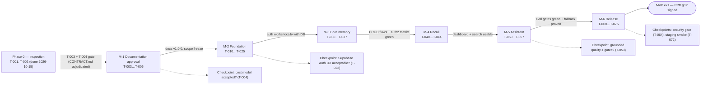

# Milestones — SmartHomeAI

| Field | Value |
|---|---|
| Version | 0.1.0 |
| Status | Draft for review |
| Date | 2026-10-15 |
| Owner | Orchestrator (role matrix: [../agents/AGENT_SPEC.md](../agents/AGENT_SPEC.md)) |
| Tasks source | [TASK_BREAKDOWN.md](TASK_BREAKDOWN.md) (`T-` IDs) · Phases: [IMPLEMENTATION_PLAN.md](IMPLEMENTATION_PLAN.md) |
| Exit authority | [DEFINITION_OF_DONE.md](DEFINITION_OF_DONE.md) per-task/phase checklists; MVP exit = [../product/PRD.md](../product/PRD.md) §17 |

> **No calendar dates are planned.** This documentation phase contains no effort estimates, so
> sequencing below is **relative** ("after M-x"). Dates are only introduced after T-004, when the
> stakeholder approves scope and the team can estimate. Milestones are **sequential**;
> parallelism happens *inside* a milestone where [TASK_BREAKDOWN.md](TASK_BREAKDOWN.md) marks
> tasks parallel (e.g., T-030 ∥ T-032).

---

## 1. Milestone overview

| ID | Milestone | Phase(s) | Tasks | One-line goal | Depends on |
|---|---|---|---|---|---|
| M-1 | Documentation approval | 1 | T-003…T-006 | Freeze scope & contracts; **CONTRACT registry adjudication done 2026-10-17** (see [../CONTRACT.md](../CONTRACT.md) §0) | Phase 0 (T-001, T-002 — **done** 2026-10-15) |
| M-2 | Foundation | 2–3 | T-010…T-025 | Working foundation: scaffold + CI + auth works locally with a real DB | M-1 |
| M-3 | Core memory | 4 | T-030…T-037 | Item/location/event flows usable; authorization matrix green | M-2 |
| M-4 | Recall | 5 | T-040…T-044 | Dashboard + deterministic search usable without AI | M-3 |
| M-5 | Assistant | 6 | T-050…T-057 | Grounded NL assistant; eval gates green; fallback proven | M-4 |
| M-6 | Release | 7–8 | T-060…T-075 | Hardened, deployed, released against PRD §17 | M-5 |

---

## 2. M-1 — Documentation approval (Phase 1)

- **Goal:** Freeze the MVP scope, contracts, and cost model, and resolve the one blocking
  documentation conflict before any application code is written
  ([../index.md §5](../index.md) item 4).
- **Tasks:** T-003 (cross-consistency review **+ `docs/CONTRACT.md` adjudication**),
  T-004 (human approval of PRD, ADRs, cost model), T-005 (countersign agent roles),
  T-006 (docs v1.0.0 + CHANGELOG entry).
- **Depends on:** Phase 0 complete — T-001, T-002 recorded **done** (2026-10-15).

**Exit criteria (all with recorded evidence):**
- [ ] T-003 findings list produced; every finding resolved or explicitly deferred with rationale.
- [ ] **`docs/CONTRACT.md` adjudicated** — a human records which registry wins; until then
      implementers follow [../index.md](../index.md), not CONTRACT.md.
- [ ] T-004 written stakeholder approval note in CHANGELOG (includes the *cost model accepted*
      risk checkpoint — [IMPLEMENTATION_PLAN §4](IMPLEMENTATION_PLAN.md)).
- [ ] T-005 AGENT_SPEC §7 countersigned; T-006 docs versioned to v1.0.0 + CHANGELOG entry.
- [ ] License decision recorded (risk R-15) as part of T-004 review.
- [ ] **No application code exists before this gate passes** (IMPLEMENTATION_PLAN §3).

**Deliverables to stakeholders:** approved PRD + ADRs + cost model (v1.0.0 documentation set),
adjudication record for CONTRACT.md, countersigned role/permission matrix, CHANGELOG approval
entry.

---

## 3. M-2 — Foundation (Phases 2–3)

- **Goal:** A boring, working foundation: pinned scaffold, CI as referee, real authentication
  against a real database — all local/dev, no AWS beyond the Amplify-hosted dev app (database
  and auth on Supabase Free).
- **Tasks:** T-010…T-015 (scaffold, lint/format, CI pipeline, tokens/theme, app shell,
  shared Zod schemas) and T-020…T-025 (Supabase project as primary Postgres 16 target,
  migrations + seed, auth module, user upsert/preferences, auth UI).
- **Depends on:** M-1 (approval T-004 gates every code task).

**Exit criteria (all with recorded evidence):**
- [ ] Phase 2: `npm run dev` / `build` / `lint` / `typecheck` / `test` all green in CI on the
      scaffold (IMPLEMENTATION_PLAN §1).
- [ ] Phase 3: signup → login → session works **against the Supabase project** (T-020's
      primary target; a native/Docker PostgreSQL 16 fallback may be used for local dev only —
      Docker is **not installed** on the inspected machine, so the chosen path must be
      documented in T-020 evidence; risk R-08).
- [ ] Migrations V1 (init) / V2 (search SQL) / V3 (location uniques) applied + seed script runs;
      `npx prisma validate` still passing (recorded PASSED 2026-10-15, Prisma CLI 6.19.3).
- [ ] `requireUser()` guard + `GET /api/me` proven by IT-001-1, IT-001-2; auth UI recorded by
      E2E-001-1 (test definitions: [TEST_PLAN.md](TEST_PLAN.md)).
- [ ] Risk checkpoint after T-023: **Supabase Auth UX acceptable in a real browser?**
      (assumption A-7; fallback: Auth.js — documented in SECURITY.md).

**Deliverables to stakeholders:** runnable dev build with working registration/login/recovery
demo, green CI link, recorded migration/seed output, env-var contract in `.env.example`.

---

## 4. M-3 — Core memory (Phase 4)

- **Goal:** The product's data model becomes real: items, locations, and append-only location
  events, with server-side ownership enforced everywhere.
- **Tasks:** T-030 (locations API), T-031 (locations UI), T-032 (items API), T-033 (items UI),
  T-034 (events API), T-035 (item detail + timeline), T-036 (correction flows),
  T-037 (ownership-matrix test suite).
- **Depends on:** M-2 (migrations T-021 + auth guard T-023).
- **Internal parallelism:** T-030 ∥ T-032 (API tracks), then UI tracks follow their APIs.

**Exit criteria (all with recorded evidence):**
- [ ] Full item/location/event flows usable in the UI: create, view, edit, soft-delete/restore,
      archive, location hierarchy (depth ≤ 3, sibling uniqueness), event timeline newest-first,
      correction appends a new event (FR-002…FR-004, FR-011, FR-016, FR-017).
- [ ] **Authorization matrix green:** IT-012-1 passes for every endpoint × cross-user negative
      (T-037 deliverable `tests/integration/authorization.matrix.test.ts`) — this is the FR-012
      / R-04 gate.
- [ ] Phase-4 test IDs green: UT-002-1, UT-003-1, UT-004-1, UT-017-1, IT-002-1, IT-003-1,
      IT-004-1, IT-011-1, IT-016-1, IT-017-1, E2E-002-1, E2E-016-1 (full catalog:
      [TEST_PLAN.md](TEST_PLAN.md)).
- [ ] Full regression suite green before milestone exit ([DEFINITION_OF_DONE.md §c](DEFINITION_OF_DONE.md)).

**Deliverables to stakeholders:** working inventory-management demo (recorded walkthrough),
authorization-matrix test output, updated API/DB docs traveling with the code.

---

## 5. M-4 — Recall (Phase 5)

- **Goal:** Recall without AI: the dashboard and deterministic search must be genuinely useful
  before the assistant layer exists (graceful-degradation principle).
- **Tasks:** T-040 (search repo + API ranking), T-041 (search UI), T-042 (dashboard
  aggregations), T-043 (dashboard page + empty states), T-044 (inventory table hardening).
- **Depends on:** M-3 (items/events data + services to aggregate over).

**Exit criteria (all with recorded evidence):**
- [ ] Search usable: ranking order exact > prefix > fuzzy (trigram) > FTS rank, archived ranked
      below active, owner-scoped, empty/degenerate queries handled (FR-005 — IT-005-1,
      UT-005-1, E2E-005-1).
- [ ] Dashboard usable: real aggregates only, onboarding empty state, inline error + partial-
      failure rendering (FR-015 — IT-015-1, E2E-015-1).
- [ ] Inventory table: filters, sort, pagination, responsive fallback verified (T-044).
- [ ] Full regression suite green before milestone exit.

**Deliverables to stakeholders:** recall demo (search + dashboard against seeded local data),
recorded E2E output, updated SEARCH/DASHBOARD docs in the same change as code.

---

## 6. M-5 — Assistant (Phase 6)

- **Goal:** The differentiator: natural-language questions answered from retrieved records only,
  with confirmed writes, honest fallback, and **measured** eval gates.
- **Tasks:** T-050 (LlmProvider + GroqProvider + MockProvider), T-051 (prompts + output
  schemas), T-052 (retrieval service), T-053 (pipeline + grounding validator + clarification),
  T-054 (assistant API + pendingAction lifecycle), T-055 (assistant UI), T-056 (AI evaluation
  suite + recorded live run), T-057 (degradation UX).
- **Depends on:** M-4 (search.repo is the retrieval backbone — FR-007/T-052).

**Exit criteria (all with recorded evidence):**
- [ ] Assistant round-trips: message → intent → retrieval → grounded reply → persisted
      conversation (IT-006-1, IT-023-1, E2E-006-1).
- [ ] Confirmed writes: pendingAction → confirm persists via the normal validated path; cancel
      and 24 h expiry write nothing (IT-024-1, IT-024-2, BR-02).
- [ ] **Eval gates green** ([TEST_PLAN.md](TEST_PLAN.md) §5): intent accuracy ≥ 90%,
      grounded-answer correctness ≥ 70%, **fabricated records = 0** (`npm run test:ai` output
      recorded by T-056).
- [ ] **Fallback proven:** mocked-outage tests pass (IT-013-1, UT-013-1, E2E-013-1) — inventory
      operations unaffected, 503 `AI_UNAVAILABLE` + deterministic search fallback (FR-013).
- [ ] One **recorded live-Groq run** committed (T-056) before milestone exit; no live keys in CI.
- [ ] Risk checkpoint after T-053: if grounded quality < gates → prompt iteration, then
      model/config changes within Groq, then scope discussion — **in that order**
      (IMPLEMENTATION_PLAN §4).

**Deliverables to stakeholders:** assistant demo (recorded), AI evaluation report (scores +
per-case results + live-run record), degradation/fallback demo, prompt/config documentation.

---

## 7. M-6 — Release (Phases 7–8)

- **Goal:** Harden, deploy, and prove readiness: security gate, observability, AWS staging,
  backups, budget controls, and the signed release checklist.
- **Tasks:** T-060…T-066 (rate limiting, audit events, observability, dependency/secret scan,
  security review gate, QA regression sweep, branch protection) and T-070…T-075 (CDK stack,
  Amplify wiring, staging smoke, backups + restore drill, budget alarms + cost actuals,
  release readiness).
- **Depends on:** M-5 (assistant complete — the smoke path includes an assistant round-trip).

**Exit criteria — i.e., PRD §17 release criteria, all checked with evidence
([DEFINITION_OF_DONE.md §d](DEFINITION_OF_DONE.md)):**
- [ ] All P0 FRs implemented; every P0 FR mapped to ≥ 1 automated test per
      [TRACEABILITY_MATRIX.md](TRACEABILITY_MATRIX.md) (19/19 P0 rows, no gaps).
- [ ] Security review gate passed — zero open high/critical findings (T-064; checkpoint after
      T-064 blocks Phase 8 otherwise).
- [ ] AI evaluation suite run: ≥ 70% correct, 0% fabricated; results recorded (T-056/T-075).
- [ ] Production build passes CI (lint, types, tests, build).
- [ ] Staging deploy + recorded smoke test (auth → item → event → search → assistant) — T-072;
      **staging smoke failure blocks release regardless of schedule** (IMPLEMENTATION_PLAN §4).
- [ ] Backup configured; one restore drill executed, timed, and documented (T-073;
      RTO ≤ 4 h / RPO ≤ 24 h targets in [../architecture/DISASTER_RECOVERY.md](../architecture/DISASTER_RECOVERY.md)).
- [ ] Budget alarms active (80%/100% of the ≤ USD 25/mo MVP target, PRD C-4) and
      [COST_ESTIMATION.md](COST_ESTIMATION.md) updated with actuals (T-074).
- [ ] CHANGELOG updated; DoD checklists complete (T-075; human-approved production deploy).

**Deliverables to stakeholders:** staging URL + smoke report, security findings report +
verdict, AI evaluation report, restore-drill report with measured RTO, updated cost model with
actuals, release checklist signed, v1.0.0 release tag + CHANGELOG.

---

## 8. Milestone dependency diagram (indicative — relative sequencing, no dates)

Read as: each milestone starts **after the previous one exits**; the dashed nodes are the
explicit stop points from [IMPLEMENTATION_PLAN §4](IMPLEMENTATION_PLAN.md). Calendar dates are
added only after T-004 approves the plan.

---

## 9. Risk checkpoint ↔ milestone mapping

| Checkpoint (IMPLEMENTATION_PLAN §4) | Milestone | Decision if it fails |
|---|---|---|
| T-004 — cost model accepted? | M-1 | Adjust scope/instance sizing in [COST_ESTIMATION.md](COST_ESTIMATION.md) before code; alternatives documented |
| T-023 — Supabase Auth UX acceptable? (A-7) | M-2 | Fall back to Auth.js + email service (documented in SECURITY.md) |
| T-053 — grounded-answer quality ≥ eval gates? | M-5 | Prompt iteration → model/config change within Groq → scope talk (this order) |
| T-064 — any open high-severity security finding | M-6 | Blocks Phase 8 |
| T-072 — staging smoke failure | M-6 | Blocks release regardless of schedule |

---

## 10. Notes

1. **P1 backlog (T-080…T-091) is intentionally outside M-1…M-6** — with one explicit
   exception: T-089…T-091 (ekspor data, label cetak, riwayat & saran pencarian) were pulled
   into active implementation by the product owner's decision of 2026-10-24 (the
   "explicitly parallel from M-6, decided by Product" case). Remaining P1 tasks start only after
   M-6 exit (or explicitly parallel from M-6, decided by Product); new milestones (M-7+) are
   created then — IDs M-1…M-6 are never reused.
2. **Evidence rule:** a milestone exits only when every listed exit criterion has *recorded*
   evidence (command output, test report, signed note) — see
   [DEFINITION_OF_DONE.md](DEFINITION_OF_DONE.md) and [../index.md §6](../index.md) ground rule 3.
3. **Scope changes:** anything not in [../product/PRD.md](../product/PRD.md) §8.1 becomes a
   roadmap item, not a milestone extension (risk R-07).

## Related documents

- [IMPLEMENTATION_PLAN.md](IMPLEMENTATION_PLAN.md) — phases, working agreements, checkpoints
- [TASK_BREAKDOWN.md](TASK_BREAKDOWN.md) — task-level dependencies and verification commands
- [RISKS.md](RISKS.md) — risk register behind the checkpoint table above
- [DEFINITION_OF_DONE.md](DEFINITION_OF_DONE.md) — what "exit" means per task/phase/release
- [TEST_PLAN.md](TEST_PLAN.md) — test IDs referenced in the exit criteria
